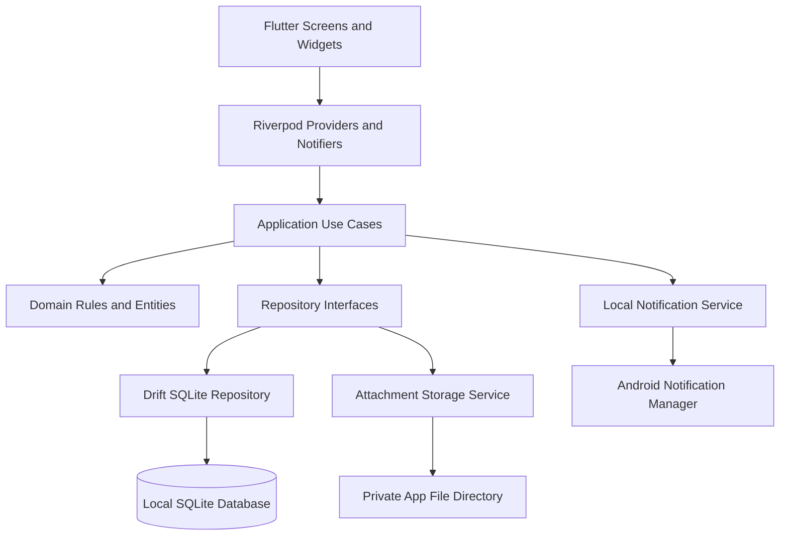

# FUNCTIONAL SPECIFICATION DOCUMENT (FSD)

# ServisKu

**Versi dokumen:** 1.0  
**Tanggal:** 6 November 2026  
**Dokumen acuan:** PRD_ServisKu_v1.1, 6 November 2026  
**Platform target:** Android  
**Framework:** Flutter dan Dart  
**Status:** Spesifikasi fungsional dan teknis untuk implementasi MVP  
**Jenis aplikasi:** Mobile personal vehicle maintenance tracker  

---

## Riwayat Dokumen

| Versi | Tanggal | Perubahan |
|---|---|---|
| 1.0 | 6 November 2026 | Penyusunan FSD berdasarkan PRD ServisKu v1.1. Mencakup modul, alur, arsitektur, struktur data, aturan bisnis, notifikasi, keamanan, antarmuka, dan pengujian. |

## 1. Pendahuluan

### 1.1 Tujuan Dokumen

Dokumen ini menjabarkan kebutuhan dalam PRD ServisKu v1.1 menjadi spesifikasi yang dapat digunakan oleh developer, UI/UX designer, dan tester selama pengembangan aplikasi. FSD menjelaskan perilaku setiap fitur, data yang diproses, validasi, aturan bisnis, alur interaksi, kondisi gagal, dan hasil yang diharapkan.

Dokumen ini menjadi acuan implementasi MVP. Fitur P1 dan P2 tetap dicantumkan sebagai rancangan lanjutan, tetapi tidak boleh menghambat penyelesaian fitur P0.

### 1.2 Deskripsi Sistem

ServisKu adalah aplikasi Android untuk membantu pemilik satu atau beberapa sepeda motor dalam satu perangkat mengelola data kendaraan, pembacaan odometer, jadwal perawatan, riwayat kunjungan servis, lampiran foto bukti servis, pengingat lokal, dan laporan biaya.

Aplikasi menggunakan pendekatan offline-first. Data utama disimpan di SQLite pada perangkat. Foto disimpan di direktori privat aplikasi. MVP tidak menyediakan login, akun, backend, API server, analitik pihak ketiga, GPS, atau sinkronisasi cloud.

### 1.3 Sasaran Pengguna

Pengguna utama adalah pemilik sepeda motor pribadi yang ingin menyimpan catatan perawatan dan pengeluaran kendaraannya. Aplikasi bukan perangkat operasional bengkel dan tidak menyediakan pengelolaan pelanggan, mekanik, stok, transaksi kasir, atau booking.

### 1.4 Istilah

| Istilah | Definisi dalam sistem |
|---|---|
| Kendaraan / motor | Satu sepeda motor yang disimpan pengguna di aplikasi. |
| Kendaraan aktif | Motor yang sedang menjadi konteks utama dashboard. |
| Odometer | Angka jarak tempuh kendaraan dalam kilometer. |
| Pembacaan odometer | Catatan angka kilometer beserta tanggal dan sumber pencatatannya. |
| Jadwal perawatan | Rencana pekerjaan perawatan berdasarkan kilometer, waktu, atau keduanya. |
| Siklus jadwal | Periode dari satu penyelesaian perawatan sampai jatuh tempo berikutnya. |
| Kunjungan servis | Satu kejadian servis pada tanggal dan kilometer tertentu. |
| Item pekerjaan | Pekerjaan atau komponen yang ditangani dalam satu kunjungan servis. |
| Lampiran | Foto nota atau bukti servis yang terhubung ke kunjungan servis. |
| Notifikasi lokal | Pemberitahuan yang dijadwalkan oleh aplikasi pada perangkat tanpa server push. |
| P0 | Fitur wajib pada MVP. |
| P1 | Fitur lanjutan setelah alur inti stabil. |
| P2 | Pengembangan lanjutan di luar target MVP. |

### 1.5 Acuan dan Batas Interpretasi

PRD ServisKu v1.1 menjadi sumber kebutuhan produk dan batas ruang lingkup. Detail teknis yang tidak ditentukan secara eksplisit dalam PRD ditandai sebagai keputusan implementasi atau rekomendasi teknis pada FSD ini. Detail tersebut tidak mengubah tujuan produk.

---

## 2. Ruang Lingkup Sistem

### 2.1 Fitur MVP P0

| Modul | Fitur | Hasil utama |
|---|---|---|
| Inisialisasi | Splash, onboarding, pembuatan motor pertama | Pengguna dapat memulai aplikasi tanpa akun. |
| Kendaraan | Tambah, lihat, ubah, hapus, pilih motor aktif | Satu atau beberapa motor tersimpan secara lokal. |
| Odometer | Input manual, validasi, riwayat pembacaan | Angka kilometer terkini menjadi acuan jadwal. |
| Dashboard | Ringkasan motor, status jadwal, servis terakhir, biaya bulan ini | Pengguna langsung melihat kondisi kendaraan aktif. |
| Jadwal perawatan | Template, jadwal kustom, status dan perhitungan jatuh tempo | Pengguna dapat memantau perawatan berdasarkan km dan/atau tanggal. |
| Riwayat servis | Buat, lihat, ubah, hapus kunjungan beserta item pekerjaan | Seluruh pekerjaan dan biaya tersimpan berdasarkan kendaraan. |
| Lampiran | Pilih foto dari galeri atau kamera, tampilkan, hapus | Foto nota tersimpan secara privat di perangkat. |
| Pengingat | Notifikasi tanggal dan evaluasi setelah input odometer | Pengguna mendapat pemberitahuan sesuai konfigurasi dan izin perangkat. |
| Laporan | Total biaya, periode, grafik dan kategori | Pengeluaran dapat dievaluasi berdasarkan kendaraan dan periode. |
| Pengaturan | Preferensi pengingat, informasi aplikasi, privasi, hapus data | Pengguna dapat mengelola preferensi dan data lokal. |

### 2.2 Fitur P1

1. Pencarian riwayat berdasarkan nama pekerjaan, bengkel, atau catatan.
2. Filter berdasarkan kendaraan, kategori, dan rentang tanggal.
3. Backup dan restore database beserta lampiran.
4. Light mode dan dark mode sebagai preferensi tema.
5. Halaman SCR-15 untuk alur backup dan restore.

Fitur P1 hanya boleh masuk rilis setelah seluruh alur P0 stabil. Backup yang berisi data pengguna harus divalidasi dan strategi enkripsi harus ditentukan sebelum distribusi publik.

### 2.3 Fitur P2

1. Kunci aplikasi menggunakan PIN atau autentikasi biometrik.
2. Sinkronisasi cloud lintas perangkat.
3. Ekspor laporan PDF.

Fitur P2 bukan syarat penerimaan MVP dan tidak boleh disimulasikan seolah-olah sudah tersedia.

### 2.4 Fitur yang Tidak Dikembangkan

- Booking atau pemesanan bengkel.
- Marketplace suku cadang atau layanan.
- Sistem kasir, inventaris, atau manajemen bengkel.
- Pelacakan GPS kendaraan.
- Pembacaan odometer otomatis.
- Diagnosis kerusakan mesin.
- Rekomendasi teknis universal pengganti buku manual atau mekanik.
- Login, akun, backend, push notification server, dan cloud sync pada MVP.

---

## 3. Pengguna, Hak Akses, dan Asumsi Operasional

### 3.1 Aktor

| Aktor | Hak akses |
|---|---|
| Pemilik motor | Mengelola seluruh data yang tersimpan pada instalasi aplikasi di perangkatnya. |
| Sistem aplikasi | Memvalidasi input, menyimpan data, menghitung status jadwal, mengelola file, dan menjadwalkan notifikasi lokal. |
| Android OS | Menyediakan galeri, kamera, izin notifikasi, penyimpanan privat, dan mekanisme penyampaian notifikasi. |

Tidak ada role admin, bengkel, mekanik, atau pengguna terautentikasi dalam MVP.

### 3.2 Asumsi Operasional

1. Satu instalasi aplikasi digunakan secara personal oleh pemilik motor.
2. Pengguna bertanggung jawab memasukkan angka odometer secara manual.
3. Semua tanggal perawatan menggunakan tanggal lokal perangkat.
4. Zona waktu perangkat dapat berubah. Aplikasi harus menghitung ulang jadwal tanggal lokal ketika aplikasi aktif kembali.
5. Aplikasi dapat digunakan tanpa koneksi internet.
6. Jika izin notifikasi ditolak, fitur pencatatan dan pemantauan jadwal tetap tersedia.
7. Data lokal dapat hilang ketika aplikasi dihapus atau data aplikasi dibersihkan apabila belum dicadangkan.
8. Template perawatan adalah titik awal pencatatan, bukan rekomendasi teknis resmi.

### 3.3 Ketergantungan Eksternal Perangkat

- Android Camera atau Photo Picker untuk input gambar.
- Android Notification Manager untuk notifikasi lokal.
- Sistem file privat aplikasi untuk foto.
- SQLite untuk penyimpanan data.

Tidak ada ketergantungan pada layanan web untuk menjalankan fitur P0.

---

## 4. Arsitektur Aplikasi

### 4.1 Stack Teknologi

| Area | Teknologi acuan | Tanggung jawab |
|---|---|---|
| Mobile framework | Flutter | UI dan runtime aplikasi Android. |
| Bahasa | Dart | Implementasi seluruh lapisan aplikasi. |
| State management | Riverpod | Dependency injection, state, dan koordinasi use case. |
| Navigation | go_router | Route, navigasi, dan redirect onboarding. |
| Database | SQLite melalui Drift | Persistensi data relasional dan query bertipe. |
| Local notification | flutter_local_notifications | Penjadwalan dan pembatalan notifikasi lokal. |
| Grafik | fl_chart | Grafik pengeluaran. |
| Image selection | image_picker | Memilih gambar atau mengambil foto. |
| File path | path_provider | Menentukan direktori privat aplikasi. |
| Formatting | intl | Format tanggal dan rupiah. |

Versi package dipilih ketika implementasi dimulai dengan memeriksa kompatibilitas terhadap versi Flutter stable yang digunakan. Dokumen ini tidak mengunci versi dependency tertentu.

### 4.2 Pola Arsitektur

Gunakan pemisahan empat lapisan berikut.

**Presentation Layer**
- Screen, widget, komponen visual, form, dialog, dan navigasi.
- Tidak menjalankan query SQLite langsung.
- Tidak berisi perhitungan jatuh tempo atau aturan biaya.

**Application Layer**
- Riverpod providers dan notifiers.
- Use case untuk alur seperti tambah kendaraan, update odometer, simpan servis, dan hitung laporan.
- Mengatur urutan operasi lintas repository dan service.

**Domain Layer**
- Entity dan value object.
- Enum status dan kategori.
- Aturan validasi dan perhitungan bisnis.
- Kalkulator jadwal perawatan dan total biaya.
- Tidak bergantung pada widget Flutter atau implementasi SQLite.

**Data Layer**
- Drift database dan migration.
- Implementasi repository.
- Penyimpanan file privat.
- Adapter notifikasi lokal.
- Mapping row database menjadi domain entity.

### 4.3 Diagram Alur Arsitektur



### 4.4 Prinsip Arsitektur

1. SQLite adalah sumber utama data terstruktur.
2. Foto disimpan di direktori privat, bukan sebagai BLOB di SQLite.
3. UI tidak boleh menghitung status jadwal secara langsung.
4. Seluruh operasi multi-tabel yang saling terkait menggunakan transaksi database.
5. File operation dan database operation harus mempunyai strategi kompensasi ketika salah satunya gagal.
6. Repository menyediakan operasi yang dapat diuji secara terpisah.
7. Tidak ada request jaringan dalam alur P0.
8. Perubahan skema database harus melalui migration.

### 4.5 Struktur Folder yang Disarankan

```text
lib/
  main.dart
  app/
    app.dart
    router/
      app_router.dart
      route_names.dart
    theme/
      app_theme.dart
      app_colors.dart
      app_typography.dart
    providers/
      app_providers.dart
  core/
    constants/
    errors/
    extensions/
    formatters/
    validators/
    widgets/
    services/
      notification_service.dart
      attachment_storage_service.dart
      permission_service.dart
      app_lifecycle_service.dart
  database/
    app_database.dart
    tables/
    daos/
    migrations/
  features/
    onboarding/
      data/
      domain/
      application/
      presentation/
    motorcycles/
      data/
      domain/
      application/
      presentation/
    odometer/
      data/
      domain/
      application/
      presentation/
    dashboard/
      application/
      presentation/
    maintenance/
      data/
      domain/
      application/
      presentation/
    service_records/
      data/
      domain/
      application/
      presentation/
    reports/
      data/
      domain/
      application/
      presentation/
    settings/
      data/
      domain/
      application/
      presentation/
    backup/
      data/
      domain/
      application/
      presentation/
  assets/
    illustrations/
    icons/
    animations/
    templates/

test/
  unit/
  widget/
  integration/
```

Folder dapat disesuaikan, tetapi pemisahan fitur dan tanggung jawab harus tetap terjaga. Jangan membuat seluruh aplikasi dalam satu file atau menempatkan semua logika di dalam widget.

### 4.6 Repository dan Use Case Utama

| Repository / service | Operasi minimum |
|---|---|
| MotorcycleRepository | watchAll, getById, create, update, delete, setActive |
| OdometerRepository | watchReadings, getLatestReading, addReading, correctReading |
| MaintenanceRepository | watchSchedules, getSchedule, create, update, deactivate, delete, recalculate |
| ServiceRecordRepository | watchRecords, getRecordDetail, create, update, delete |
| ReportRepository | getSummary, getMonthlyTotals, getCategoryTotals |
| SettingsRepository | getSetting, setSetting, clearUserData |
| AttachmentStorageService | pickImage, validate, copyToPrivateStorage, createThumbnail, deleteFile |
| NotificationService | requestPermission, schedule, cancel, cancelAllForSchedule, reconcile |

Use case utama:

- InitializeApplicationUseCase
- CompleteOnboardingUseCase
- CreateMotorcycleUseCase
- UpdateMotorcycleUseCase
- DeleteMotorcycleUseCase
- SelectActiveMotorcycleUseCase
- AddOdometerReadingUseCase
- CorrectOdometerReadingUseCase
- CreateMaintenanceScheduleUseCase
- UpdateMaintenanceScheduleUseCase
- EvaluateMaintenanceStatusUseCase
- CreateServiceRecordUseCase
- UpdateServiceRecordUseCase
- DeleteServiceRecordUseCase
- AttachServicePhotoUseCase
- RecalculateMaintenanceAfterServiceUseCase
- GenerateExpenseReportUseCase
- ReconcileLocalNotificationsUseCase
- ClearAllLocalDataUseCase

---

## 5. Navigasi dan Struktur Route

### 5.1 Navigasi Utama

Navigasi bawah memiliki empat menu:

1. Beranda.
2. Kendaraan.
3. Riwayat.
4. Laporan.

Tombol aksi tambah catatan servis harus mudah ditemukan dari dashboard dan detail kendaraan. Pengaturan dibuka melalui ikon pengaturan pada Beranda.

### 5.2 Route Aplikasi

| Route | Halaman | Keterangan |
|---|---|---|
| `/splash` | SCR-01 | Route awal sementara. |
| `/onboarding` | SCR-02 | Hanya untuk instalasi yang belum menyelesaikan onboarding. |
| `/vehicles/new` | SCR-03 | Tambah motor pertama atau motor tambahan. |
| `/home` | SCR-04 | Dashboard dan navigasi utama. |
| `/vehicles` | SCR-05 | Daftar motor. |
| `/vehicles/:id` | SCR-06 | Detail motor. |
| `/vehicles/:id/odometer` | SCR-07 | Input dan riwayat odometer. |
| `/vehicles/:id/maintenance` | SCR-08 | Daftar jadwal perawatan. |
| `/maintenance/new?vehicleId=:id` | SCR-09 | Membuat jadwal. |
| `/maintenance/:id/edit` | SCR-09 | Mengubah jadwal. |
| `/history` | SCR-10 | Riwayat servis. |
| `/service-records/new?vehicleId=:id` | SCR-11 | Membuat kunjungan servis. |
| `/service-records/:id/edit` | SCR-11 | Mengubah kunjungan servis. |
| `/service-records/:id` | SCR-12 | Detail kunjungan servis. |
| `/reports` | SCR-13 | Laporan biaya. |
| `/settings` | SCR-14 | Pengaturan. |
| `/settings/backup` | SCR-15 | Backup dan restore, P1. |

### 5.3 Aturan Redirect dan Navigasi

1. Saat aplikasi mulai, sistem memeriksa status inisialisasi dan jumlah kendaraan.
2. Jika inisialisasi pertama belum selesai, arahkan ke onboarding.
3. Jika onboarding selesai tetapi belum ada kendaraan, arahkan ke tambah motor.
4. Jika minimal satu kendaraan tersedia, arahkan ke Beranda.
5. Kendaraan aktif terakhir dipulihkan dari `app_settings`.
6. Jika ID kendaraan aktif tidak lagi tersedia, pilih kendaraan aktif pertama berdasarkan urutan yang konsisten.
7. Jika kendaraan terakhir dihapus, arahkan pengguna ke alur tambah motor.
8. Route detail dengan ID yang tidak ditemukan menampilkan halaman tidak ditemukan dengan tombol kembali, bukan crash.
9. Route backup hanya ditampilkan ketika modul P1 diaktifkan pada build.

---

## 6. Spesifikasi Halaman

### 6.1 SCR-01: Splash

**Tujuan:** Menampilkan identitas ServisKu saat aplikasi mulai dan menyiapkan data awal.

**Komponen:**
- Logo atau wordmark ServisKu.
- Ilustrasi motor atau elemen visual singkat.
- Indikator proses ringan jika inisialisasi membutuhkan waktu.

**Proses sistem:**
1. Inisialisasi Flutter dan dependency.
2. Buka database lokal dan jalankan pemeriksaan migration.
3. Baca status onboarding dan kendaraan.
4. Baca kendaraan aktif terakhir.
5. Jalankan rekonsiliasi singkat status jadwal dan notifikasi apabila diperlukan.
6. Arahkan pengguna sesuai aturan redirect.

**Kondisi gagal:**
- Jika database tidak dapat dibuka, tampilkan halaman pemulihan dengan pesan yang mudah dipahami.
- Jangan menghapus atau membuat ulang database secara otomatis.
- Sediakan tindakan mencoba kembali dan informasi untuk menghubungi pengembang pada build demonstrasi.

**Kriteria selesai:** aplikasi berhasil menentukan halaman awal tanpa meminta login.

### 6.2 SCR-02: Onboarding

**Tujuan:** Menjelaskan manfaat utama aplikasi dan mengarahkan pengguna membuat motor pertama.

**Komponen:**
- Ilustrasi motor dan aktivitas perawatan.
- Maksimal beberapa panel ringkas mengenai catatan servis, jadwal, dan biaya.
- Tombol `Mulai`.
- Tombol `Lewati`.

**Interaksi:**
1. Pengguna dapat berpindah panel secara manual.
2. Animasi ilustrasi berjalan singkat dan tidak mengunci tombol.
3. Tombol Mulai dan Lewati membuka SCR-03.
4. Status onboarding disimpan setelah alur onboarding selesai atau saat pengguna memilih Lewati.

**Validasi:** tidak ada input kendaraan pada halaman ini.

**Empty/error state:** jika ilustrasi gagal dimuat, gunakan placeholder statis lokal. Onboarding tetap dapat diselesaikan.

### 6.3 SCR-03: Tambah Motor

**Tujuan:** Membuat data kendaraan pertama atau menambahkan motor berikutnya.

**Field form:**

| Field | Tipe | Wajib | Validasi |
|---|---|---|---|
| Nama panggilan | Text | Ya | Tidak boleh kosong setelah trim. |
| Merek | Text / pilihan | Ya | Tidak boleh kosong. |
| Model atau varian | Text | Ya | Tidak boleh kosong. |
| Tipe motor | Pilihan | Ya | Matic, bebek, atau sport. |
| Tahun produksi | Integer | Tidak | Tahun valid dan tidak melebihi tahun kalender saat ini. |
| Nomor polisi | Text | Tidak | Trim whitespace; simpan apa adanya setelah normalisasi ringan. |
| Jenis penggerak | Pilihan | Ya | Bensin atau listrik. Default yang dapat dipilih pengguna. |
| Kilometer saat ini | Integer | Ya | Bilangan bulat, tidak negatif. |
| Catatan | Multiline text | Tidak | Batas panjang ditetapkan pada implementasi UI. |

**Catatan foto motor:** foto kendaraan merupakan opsi personalisasi yang dapat ditambahkan setelah MVP. Pada MVP, dashboard menggunakan ilustrasi bawaan jika belum ada foto.

**Proses simpan:**
1. Validasi seluruh field wajib.
2. Buat UUID kendaraan.
3. Simpan baris ke `motorcycles`.
4. Buat pembacaan odometer awal pada `odometer_readings` dengan sumber `manual` dan tanggal lokal saat pembuatan.
5. Simpan ID kendaraan sebagai kendaraan aktif jika ini motor pertama atau pengguna memilihnya sebagai aktif.
6. Simpan operasi database dalam satu transaksi.
7. Jika transaksi gagal, jangan menampilkan keberhasilan dan jangan meninggalkan baris parsial.
8. Jika berhasil, buka SCR-04 atau kembali ke daftar kendaraan sesuai konteks pemanggilan.

**Validasi dan pesan:**
- Nama kosong: `Nama motor wajib diisi.`
- Merek atau model kosong: tampilkan validasi di field terkait.
- Kilometer kosong atau negatif: `Masukkan kilometer yang valid.`
- Tahun tidak valid: `Periksa kembali tahun produksi.`

**Kriteria selesai:** data kendaraan dan pembacaan odometer awal tersimpan secara atomik.

### 6.4 SCR-04: Beranda / Dashboard

**Tujuan:** Menampilkan ringkasan motor aktif dan informasi perawatan paling penting.

**Komponen utama:**
1. Header sambutan dan akses Pengaturan.
2. Vehicle hero berisi foto motor pengguna jika kelak tersedia, atau ilustrasi lokal.
3. Nama motor, model, dan kilometer terakhir.
4. Tanggal pembaruan kilometer terakhir.
5. Ringkasan jumlah jadwal terlambat dan segera.
6. Satu jadwal paling mendesak atau maksimal tiga jadwal prioritas.
7. Ringkasan aktivitas servis terakhir.
8. Total biaya bulan berjalan untuk kendaraan aktif.
9. Tombol aksi `Tambah catatan servis`.
10. Navigasi bawah empat menu.

**Sumber data:**
- Kendaraan aktif dari SettingsRepository.
- Kilometer terakhir dari OdometerRepository.
- Status jadwal dari EvaluateMaintenanceStatusUseCase.
- Servis terbaru dari ServiceRecordRepository.
- Total biaya bulan berjalan dari ReportRepository.

**Urutan jadwal pada dashboard:**
1. Terlambat ditampilkan lebih dahulu.
2. Berikutnya jadwal Segera.
3. Di dalam status yang sama, urutkan berdasarkan sisa km atau hari terkecil.
4. Batasi tampilan menjadi maksimal tiga jadwal.

**Interaksi:**
- Ketuk kendaraan aktif untuk membuka pemilih kendaraan.
- Ketuk jadwal untuk membuka detail jadwal.
- Ketuk aktivitas servis untuk membuka SCR-12.
- Ketuk Perbarui Kilometer untuk membuka SCR-07.
- Ketuk Tambah catatan servis untuk membuka SCR-11 dengan kendaraan aktif terpilih.
- Ketuk Laporan untuk membuka SCR-13.

**Empty state:**
- Belum ada jadwal: ilustrasi dan ajakan `Atur jadwal perawatan`.
- Belum ada riwayat: ilustrasi dan ajakan `Catat servis pertama`.
- Belum ada biaya: tampilkan nilai Rp0 dan penjelasan bahwa laporan akan terisi setelah pengguna mencatat servis.

**Loading/error:** gunakan placeholder ukuran tetap agar layout tidak melompat. Jika satu bagian gagal dimuat, tampilkan fallback di bagian tersebut dan pertahankan bagian lain.

### 6.5 SCR-05: Daftar Kendaraan

**Tujuan:** Menampilkan dan mengelola motor pengguna.

**Informasi per item:**
- Ilustrasi atau foto kendaraan.
- Nama panggilan.
- Merek dan model.
- Tipe motor.
- Kilometer terakhir.
- Penanda kendaraan aktif.

**Interaksi:**
- Ketuk item untuk membuka SCR-06.
- Tombol Tambah Motor membuka SCR-03.
- Aksi `Jadikan aktif` mengubah kendaraan aktif dan memperbarui dashboard.
- Aksi ubah membuka SCR-03 dalam mode edit.
- Aksi hapus membuka dialog konfirmasi dengan konsekuensi penghapusan seluruh jadwal, riwayat servis, pembacaan odometer, dan lampiran terkait.

**Penghapusan:**
1. Pengguna menekan Hapus.
2. Dialog menjelaskan data turunan yang ikut dihapus.
3. Pengguna harus memilih Batal atau Hapus Motor.
4. Sistem menghapus notifikasi seluruh jadwal motor tersebut.
5. Sistem menghapus data relasional dan metadata lampiran dengan cascade database.
6. Sistem membersihkan file lampiran dari direktori privat.
7. Jika motor aktif dihapus, pilih kendaraan lain atau buka alur tambah motor.

**Kriteria selesai:** daftar menampilkan semua kendaraan aktif dan perubahan data tercermin setelah operasi.

### 6.6 SCR-06: Detail Kendaraan

**Tujuan:** Menampilkan profil dan ringkasan satu motor.

**Komponen:**
- Foto atau ilustrasi motor.
- Nama panggilan, merek, model, tipe, tahun, penggerak, dan nomor polisi jika tersedia.
- Kilometer saat ini dan tanggal pembacaan terakhir.
- Ringkasan jadwal aman, segera, dan terlambat.
- Jadwal perawatan terdekat.
- Riwayat servis terakhir.
- Tombol Perbarui Kilometer.
- Tombol Tambah catatan servis.
- Tombol Kelola jadwal.
- Aksi Ubah dan Hapus.

**Interaksi:**
- Informasi kendaraan dapat diubah melalui SCR-03.
- Perbarui Kilometer membuka SCR-07.
- Kelola jadwal membuka SCR-08.
- Riwayat servis membuka SCR-10 dengan filter kendaraan tersebut.

**Kondisi kendaraan tidak ditemukan:** tampilkan halaman tidak ditemukan dan tombol kembali ke daftar kendaraan.

### 6.7 SCR-07: Form Odometer dan Riwayat Kilometer

**Tujuan:** Memperbarui dan memeriksa catatan kilometer motor.

**Komponen form:**
- Nama kendaraan.
- Kilometer terakhir.
- Tanggal pembacaan terakhir.
- Input kilometer baru.
- Tanggal pembacaan, default hari ini.
- Catatan opsional.
- Tombol Simpan.
- Riwayat pembacaan di bawah form atau pada tab terpisah.

**Validasi:**
1. Kilometer wajib diisi.
2. Nilai berupa integer dan tidak negatif.
3. Secara default nilai baru tidak boleh lebih rendah daripada pembacaan terakhir.
4. Jika lebih rendah, tampilkan penjelasan dan minta pengguna masuk ke alur Koreksi Odometer.
5. Koreksi membutuhkan konfirmasi eksplisit dan catatan alasan.
6. Tanggal pembacaan tidak boleh berada di masa depan.

**Proses simpan normal:**
1. Validasi nilai.
2. Simpan pembacaan odometer baru dengan sumber `manual`.
3. Perbarui tampilan kilometer kendaraan dari pembacaan terbaru berdasarkan urutan tanggal dan waktu pencatatan.
4. Evaluasi ulang seluruh jadwal aktif yang memiliki interval kilometer.
5. Perbarui atau batalkan notifikasi yang terpengaruh.
6. Tampilkan feedback `Kilometer berhasil diperbarui.`

**Proses koreksi:**
1. Tampilkan nilai lama dan nilai baru.
2. Minta konfirmasi bahwa angka baru memang koreksi pembacaan.
3. Wajibkan alasan koreksi.
4. Simpan sebagai pembacaan koreksi yang dapat dikenali dalam riwayat.
5. Hitung ulang status jadwal dengan nilai terbaru hasil koreksi.
6. Tidak boleh menghapus riwayat pembacaan sebelumnya secara diam-diam.

**Riwayat:** tampilkan nilai km, tanggal, sumber, dan catatan koreksi jika ada. Urutkan berdasarkan tanggal pembacaan terbaru, kemudian waktu pencatatan.

### 6.8 SCR-08: Daftar Jadwal Perawatan

**Tujuan:** Menampilkan seluruh jadwal perawatan untuk kendaraan yang dipilih.

**Informasi per jadwal:**
- Nama dan kategori perawatan.
- Ikon atau ilustrasi kategori.
- Interval kilometer dan/atau bulan.
- Status Aman, Segera, Terlambat, atau Belum diatur.
- Alasan status, misalnya sisa 300 km atau terlambat 5 hari.
- Penanda aktif atau nonaktif.

**Filter tampilan dasar:** Semua, Perlu perhatian, dan Nonaktif. Filter kompleks tetap tidak diperlukan untuk P0.

**Interaksi:**
- Tambah jadwal membuka SCR-09.
- Ketuk jadwal membuka detail atau panel ringkasan jadwal.
- Ubah membuka SCR-09.
- Nonaktifkan menghentikan evaluasi notifikasi tetapi mempertahankan histori.
- Hapus meminta konfirmasi.

**Template:** daftar template disesuaikan dengan kategori dan tipe kendaraan. Untuk motor listrik, aplikasi menyediakan opsi jadwal kustom. Template bensin tidak boleh ditampilkan sebagai rekomendasi teknis universal untuk motor listrik.

### 6.9 SCR-09: Form Jadwal Perawatan

**Tujuan:** Membuat atau mengubah rencana perawatan.

**Field:**

| Field | Tipe | Wajib | Validasi |
|---|---|---|---|
| Kendaraan | Referensi | Ya | Harus mengarah ke kendaraan yang tersedia. |
| Nama perawatan | Text | Ya | Tidak boleh kosong. |
| Kategori | Pilihan / custom | Tidak | Gunakan kategori template jika tersedia. |
| Interval kilometer | Integer | Salah satu interval wajib | Jika diisi harus lebih besar dari nol. |
| Interval bulan | Integer | Salah satu interval wajib | Jika diisi harus lebih besar dari nol. |
| Kilometer terakhir dilakukan | Integer | Sesuai interval km | Jika interval km dipilih, harus tersedia atau jadwal berstatus Belum diatur. |
| Tanggal terakhir dilakukan | Date | Sesuai interval waktu | Jika interval waktu dipilih, harus tersedia atau jadwal berstatus Belum diatur. |
| Pengingat sebelum jatuh tempo km | Integer | Tidak | Tidak boleh negatif. |
| Pengingat sebelum jatuh tempo hari | Integer | Tidak | Tidak boleh negatif. |
| Status aktif | Boolean | Ya | Default aktif. |

**Pilihan awal:**
- Pengguna dapat memilih template atau Buat jadwal sendiri.
- Memilih template mengisi nama dan kategori, serta interval awal hanya jika template memang mendefinisikannya.
- Jangan mengisi tanggal atau kilometer terakhir secara otomatis dengan tanggal saat ini atau angka odometer saat ini tanpa persetujuan pengguna.
- Interval template harus dapat diubah pengguna.

**Validasi utama:**
1. Minimal satu interval harus diisi.
2. Interval yang diisi harus lebih besar dari nol.
3. Baseline untuk setiap jenis interval harus tersedia agar status dapat dihitung.
4. Jika baseline belum lengkap, pengguna dapat menyimpan jadwal dalam status Belum diatur, dengan penjelasan data yang perlu dilengkapi.
5. Tanggal terakhir dilakukan tidak boleh berada di masa depan.
6. Kilometer terakhir tidak boleh negatif.

**Estimasi jatuh tempo:** tampilkan estimasi km dan/atau tanggal jika data yang diperlukan tersedia. Status dan alasan harus berasal dari kalkulator domain.

**Proses simpan:** validasi, simpan jadwal, hitung status, sinkronkan notifikasi lokal, lalu tampilkan feedback berhasil.

### 6.10 SCR-10: Riwayat Servis

**Tujuan:** Menampilkan daftar kunjungan servis.

**Informasi item:**
- Tanggal servis.
- Kendaraan.
- Kilometer saat servis.
- Nama bengkel jika tersedia.
- Ringkasan satu atau lebih pekerjaan.
- Total biaya kunjungan.
- Thumbnail lampiran jika tersedia.

**Urutan:** tanggal servis terbaru lebih dahulu. Untuk tanggal sama, gunakan waktu pembuatan terakhir sebagai urutan sekunder.

**Interaksi P0:**
- Ketuk item membuka SCR-12.
- Tombol tambah membuka SCR-11.
- Filter kendaraan dasar tersedia untuk membatasi konteks.

**Interaksi P1:**
- Pencarian nama pekerjaan, bengkel, dan catatan.
- Filter kategori dan rentang tanggal.

**Empty state:** ilustrasi nota atau peralatan servis dan ajakan mencatat servis pertama.

### 6.11 SCR-11: Form Catatan Servis

**Tujuan:** Membuat atau mengubah satu kunjungan servis yang berisi satu atau beberapa pekerjaan.

**Field tingkat kunjungan:**

| Field | Tipe | Wajib | Validasi |
|---|---|---|---|
| Kendaraan | Referensi | Ya | Kendaraan harus tersedia. |
| Tanggal servis | Date | Ya | Default hari ini; tidak boleh di masa depan secara default. |
| Kilometer saat servis | Integer | Ya | Tidak boleh kosong atau negatif. |
| Nama bengkel / lokasi | Text | Tidak | Trim whitespace. |
| Biaya tambahan | Integer | Tidak | Default Rp0, tidak boleh negatif. |
| Catatan kunjungan | Multiline | Tidak | Simpan sebagai teks biasa. |
| Foto nota | Lampiran | Tidak | Diproses terpisah setelah record utama tersimpan. |

**Field setiap item pekerjaan:**

| Field | Tipe | Wajib | Validasi |
|---|---|---|---|
| Nama pekerjaan | Text | Ya | Tidak boleh kosong. |
| Kategori | Pilihan / custom | Tidak | Kategori opsional. |
| Biaya | Integer rupiah | Ya | Tidak boleh negatif. Nilai nol diperbolehkan jika pekerjaan tidak dikenakan biaya. |
| Jadwal terkait | Referensi jadwal | Tidak | Jadwal harus milik kendaraan yang sama dan masih tersedia. |
| Catatan item | Text | Tidak | Opsional. |

**Aturan form:**
1. Satu kunjungan harus memiliki minimal satu item pekerjaan.
2. Item dapat ditambah dan dihapus selama form belum disimpan.
3. Jadwal terkait hanya menampilkan jadwal untuk kendaraan terpilih.
4. Satu jadwal tidak boleh dipilih berulang pada beberapa item dalam satu kunjungan kecuali aturan produk diubah secara eksplisit.
5. Perubahan kendaraan harus meminta pengguna meninjau ulang jadwal terkait pada item.
6. Total biaya dihitung otomatis dan diperbarui ketika biaya item atau biaya tambahan berubah.

**Formula total:**

`total_kunjungan = jumlah(item_cost) + additional_cost`

**Validasi tanggal dan odometer:**
- Tanggal masa depan ditolak secara default.
- Jika catatan servis adalah catatan historis dengan tanggal lebih lama dari pembacaan odometer terkini, simpan sebagai histori dan jangan menimpa pembacaan terkini.
- Jika tanggal servis sama atau lebih baru daripada pembacaan terkini tetapi km lebih rendah, minta pengguna memeriksa atau menggunakan alur koreksi odometer.
- Catatan servis yang valid dapat menambahkan pembacaan odometer dengan sumber `service`.

**Proses penyimpanan:**
1. Validasi header kunjungan dan semua item.
2. Hitung total biaya di domain, bukan mempercayai angka total dari UI.
3. Simpan service record dan seluruh items dalam satu transaksi SQLite.
4. Simpan pembacaan odometer dari servis jika memenuhi aturan kronologi dan validasi.
5. Perbarui jadwal yang terhubung ke item pekerjaan.
6. Recalculate jadwal yang terdampak.
7. Commit transaksi.
8. Jika ada foto terpilih, salin ke direktori privat, buat thumbnail bila diperlukan, lalu simpan metadata lampiran.
9. Kegagalan lampiran tidak membatalkan catatan servis yang sudah tersimpan. Tampilkan pesan bahwa catatan berhasil tetapi foto gagal disimpan.
10. Sinkronkan notifikasi jadwal yang berubah.
11. Buka SCR-12 atau tampilkan konfirmasi berhasil.

**Perubahan catatan:** saat edit, sistem harus membandingkan kendaraan, tanggal, kilometer, item, biaya, dan relasi jadwal yang lama dengan nilai baru. Jadwal yang sebelumnya terhubung maupun yang baru terhubung harus dihitung ulang.

### 6.12 SCR-12: Detail Servis

**Tujuan:** Menampilkan seluruh informasi kunjungan servis.

**Komponen:**
- Nama motor.
- Tanggal dan kilometer saat servis.
- Nama bengkel atau lokasi.
- Daftar item pekerjaan, kategori, biaya, jadwal terkait, dan catatan.
- Biaya tambahan.
- Total biaya.
- Galeri thumbnail lampiran.
- Catatan kunjungan.
- Tombol Ubah dan Hapus.

**Interaksi:**
- Ketuk lampiran untuk melihat gambar lebih besar.
- Hapus lampiran meminta konfirmasi dan hanya menghapus file lampiran tersebut.
- Ubah membuka SCR-11 dengan data terisi.
- Hapus menampilkan dialog. Jika item pada catatan menjadi dasar pembaruan jadwal, dialog harus menjelaskan bahwa status jadwal terkait akan dihitung ulang.

**Penghapusan:**
1. Ambil daftar path lampiran dan ID jadwal terkait.
2. Hapus service record dan item dengan transaksi database.
3. Recalculate jadwal yang terdampak berdasarkan baseline manual dan catatan servis tersisa.
4. Batalkan atau jadwalkan ulang notifikasi terkait.
5. Hapus file lampiran fisik setelah commit.
6. Jika file gagal dihapus, catat kegagalan tanpa mencatat isi nota atau data sensitif ke log. Bersihkan file yatim pada proses pemeliharaan berikutnya.
7. Kembali ke SCR-10 dan tampilkan feedback.

### 6.13 SCR-13: Laporan Biaya

**Tujuan:** Menampilkan pengeluaran perawatan berdasarkan kendaraan dan periode.

**Filter periode:**
- Bulan ini.
- Tiga bulan terakhir.
- Tahun ini.
- Rentang kustom.

**Filter kendaraan:**
- Kendaraan aktif sebagai nilai awal.
- Pengguna dapat memilih motor lain.
- Pilihan Semua Kendaraan dapat digunakan untuk ringkasan gabungan jika mendukung konteks layar.

**Komponen:**
- Total pengeluaran periode.
- Perbandingan atau ringkasan biaya per bulan.
- Grafik pengeluaran per bulan.
- Rincian biaya berdasarkan kategori jika kategori tersedia.
- Daftar transaksi yang membentuk total, bila ruang layar memungkinkan.
- Empty state saat tidak ada transaksi pada periode tersebut.

**Perhitungan:**
1. Gunakan `service_date` sebagai tanggal transaksi.
2. Gunakan total record yang dihitung dari item dan biaya tambahan.
3. Terapkan filter kendaraan dan tanggal secara konsisten.
4. Rentang kustom inklusif pada tanggal mulai dan tanggal akhir.
5. Jangan menghitung item dan total kunjungan secara bersamaan karena akan menggandakan nilai.
6. Perubahan atau penghapusan catatan servis harus langsung tercermin setelah query laporan diperbarui.

**Interaksi:**
- Mengubah filter memuat ulang ringkasan dan grafik.
- Ketuk transaksi membuka SCR-12.
- Grafik harus memiliki label periode dan nilai yang dapat dibaca tanpa bergantung pada warna saja.

### 6.14 SCR-14: Pengaturan

**Tujuan:** Mengatur preferensi aplikasi dan memberikan akses ke informasi privasi.

**Bagian pengaturan:**
1. Pengingat dan notifikasi.
2. Tema aplikasi, P1.
3. Backup dan restore, P1.
4. Informasi versi aplikasi.
5. Informasi privasi dan lokasi penyimpanan data.
6. Hapus seluruh data aplikasi.

**Pengingat:**
- Toggle pengingat global.
- Status izin notifikasi Android.
- Penjelasan bahwa penolakan izin tidak menghilangkan status jadwal di dalam aplikasi.
- Tautan atau tombol untuk membuka pengaturan izin perangkat jika dibutuhkan.

**Tema P1:** Sistem, Terang, Gelap. Light mode menjadi default utama.

**Hapus seluruh data:**
1. Pengguna memilih Hapus seluruh data.
2. Dialog pertama menjelaskan bahwa seluruh motor, jadwal, riwayat, lampiran, dan preferensi pengguna akan dihapus.
3. Pengguna harus mengonfirmasi tindakan melalui dialog kedua.
4. Sistem membatalkan seluruh notifikasi aplikasi.
5. Sistem menghapus file privat dan seluruh data aplikasi melalui urutan yang aman.
6. Setelah berhasil, aplikasi kembali ke onboarding atau tambah motor pertama.
7. Jika proses gagal, tampilkan informasi kegagalan dan jangan menyatakan seluruh data telah terhapus.

### 6.15 SCR-15: Backup dan Restore, P1

**Status:** Tidak termasuk rilis P0.

**Backup:**
1. Pengguna memilih Buat Cadangan.
2. Aplikasi mengumpulkan database dan file lampiran.
3. Aplikasi menghasilkan satu paket cadangan dengan manifest versi format dan metadata integritas.
4. Pengguna memilih lokasi penyimpanan melalui file picker sistem.
5. Aplikasi memvalidasi hasil file dan menampilkan lokasi atau status ekspor.

**Restore:**
1. Pengguna memilih file cadangan.
2. Aplikasi memvalidasi ekstensi, struktur paket, versi format, integritas, dan isi sebelum menyentuh database aktif.
3. Aplikasi menjelaskan strategi replace-all yang digunakan pada rancangan P1.
4. Pengguna mengonfirmasi penggantian seluruh data yang ada.
5. Buat salinan pemulihan sementara dari database aktif sebelum restore.
6. Restore ke database sementara, validasi relasi, kemudian lakukan pergantian atomik.
7. Jika proses gagal, database aktif harus tetap dapat digunakan.
8. Setelah restore berhasil, lakukan rekonsiliasi path lampiran dan notifikasi.

**Keamanan P1:** dukungan enkripsi paket cadangan harus ditentukan sebelum fitur dipublikasikan. Jangan mengklaim file cadangan aman atau terenkripsi jika mekanisme tersebut belum diterapkan.

---

## 7. Spesifikasi Fungsional per Modul

### 7.1 Modul Inisialisasi dan Onboarding

| ID FSD | Kebutuhan | Input | Proses | Output |
|---|---|---|---|---|
| FSD-ONB-01 | Memeriksa status inisialisasi | app_settings, jumlah motor | Baca flag onboarding dan data kendaraan | Route awal yang sesuai |
| FSD-ONB-02 | Menampilkan onboarding pertama kali | Status onboarding | Tampilkan panel pengenalan | Pengguna memahami fungsi inti |
| FSD-ONB-03 | Melewati onboarding | Aksi pengguna | Simpan flag selesai | SCR-03 |
| FSD-ONB-04 | Meminta minimal satu motor | Daftar motor kosong | Redirect ke form motor | Dashboard tidak dibuka sebelum motor ada |
| FSD-ONB-05 | Menyimpan penyelesaian onboarding | Aksi Mulai atau Lewati | Simpan preference | Onboarding tidak muncul pada pembukaan berikutnya |

### 7.2 Modul Kendaraan

| ID FSD | Kebutuhan | Input | Proses | Output |
|---|---|---|---|---|
| FSD-VEH-01 | Menambah motor | Field SCR-03 | Validasi, buat UUID, simpan motor dan odometer awal dalam transaksi | Motor muncul di daftar |
| FSD-VEH-02 | Melihat motor | Database kendaraan | Query kendaraan yang tersedia | Daftar kendaraan |
| FSD-VEH-03 | Mengubah motor | ID dan field baru | Validasi dan update timestamp | Detail dan daftar diperbarui |
| FSD-VEH-04 | Menghapus motor | ID motor dan konfirmasi | Hapus notifikasi, data turunan, file terkait | Motor dan data turunannya terhapus |
| FSD-VEH-05 | Memilih motor aktif | ID motor | Simpan ID pada app_settings | Dashboard berpindah konteks |
| FSD-VEH-06 | Mengingat motor aktif | app_settings | Baca ID saat aplikasi dimulai | Motor terakhir tetap terpilih |

### 7.3 Modul Odometer

| ID FSD | Kebutuhan | Input | Proses | Output |
|---|---|---|---|---|
| FSD-ODO-01 | Input kilometer | Nilai km, tanggal, catatan | Validasi dan simpan reading | Kilometer terbaru diperbarui |
| FSD-ODO-02 | Menolak angka negatif atau kosong | Input form | Validasi domain | Pesan validasi |
| FSD-ODO-03 | Mengelola nilai lebih rendah | Nilai baru lebih kecil | Tampilkan alur koreksi dan konfirmasi | Koreksi tercatat eksplisit |
| FSD-ODO-04 | Menampilkan riwayat | ID motor | Query seluruh reading | Timeline odometer |
| FSD-ODO-05 | Memicu evaluasi jadwal | Odometer baru | Evaluasi jadwal aktif dan reconcile notifikasi | Status dan notifikasi mutakhir |
| FSD-ODO-06 | Mencatat sumber servis | Data service record | Tambahkan reading dengan source service jika valid | Histori odometer terhubung ke servis |

### 7.4 Modul Dashboard

| ID FSD | Kebutuhan | Proses | Output |
|---|---|---|---|
| FSD-DASH-01 | Menampilkan kendaraan aktif | Ambil ID aktif dan detail motor | Hero motor dan odometer |
| FSD-DASH-02 | Menghitung jumlah status | Evaluasi seluruh jadwal aktif | Jumlah terlambat dan segera |
| FSD-DASH-03 | Menampilkan prioritas | Urutkan jadwal berdasarkan urgensi | Maksimal tiga jadwal |
| FSD-DASH-04 | Menampilkan aktivitas terakhir | Query record terbaru | Ringkasan kunjungan terakhir |
| FSD-DASH-05 | Menampilkan biaya bulan ini | Query record pada bulan lokal berjalan | Total rupiah bulan ini |
| FSD-DASH-06 | Berpindah motor | Set active motorcycle | Dashboard memuat konteks baru |
| FSD-DASH-07 | Menangani data kosong | Deteksi tidak ada jadwal atau servis | Empty state kontekstual |

### 7.5 Modul Jadwal Perawatan

| ID FSD | Kebutuhan | Input | Proses | Output |
|---|---|---|---|---|
| FSD-MNT-01 | Membuat jadwal | Data jadwal | Validasi interval dan baseline | Jadwal lokal tersimpan |
| FSD-MNT-02 | Memilih template | Jenis motor dan kategori | Muat template lokal | Form terisi nilai awal yang dapat diedit |
| FSD-MNT-03 | Membuat jadwal kustom | Nama, interval, baseline | Validasi dan simpan | Jadwal aktif |
| FSD-MNT-04 | Mengubah jadwal | ID dan nilai baru | Update, recalculate, reconcile notification | Status dan reminder diperbarui |
| FSD-MNT-05 | Menonaktifkan jadwal | ID dan aksi | Set is_active false dan batalkan notifikasi | Jadwal tidak dievaluasi |
| FSD-MNT-06 | Menghapus jadwal | ID dan konfirmasi | Hapus relasi serta notifikasi | Jadwal dihapus |
| FSD-MNT-07 | Menghitung jatuh tempo | Interval, baseline, odometer, tanggal lokal | Jalankan domain calculator | Due km, due date, dan status |
| FSD-MNT-08 | Menjelaskan status | Hasil kalkulasi | Buat keterangan km dan/atau hari | Alasan status dapat dipahami |
| FSD-MNT-09 | Menyelesaikan jadwal dari item servis | Link service item | Recalculate last done dari baseline dan histori item | Siklus jadwal baru |

### 7.6 Modul Riwayat Servis

| ID FSD | Kebutuhan | Input | Proses | Output |
|---|---|---|---|---|
| FSD-SRV-01 | Membuat kunjungan | Header dan satu atau lebih item | Validasi dan transaksi multi-tabel | Kunjungan tersimpan |
| FSD-SRV-02 | Menghitung total | Biaya item dan biaya tambahan | Jumlahkan dalam integer rupiah | Total akurat |
| FSD-SRV-03 | Melihat detail | ID kunjungan | Join header, items, attachments, schedule | Detail lengkap |
| FSD-SRV-04 | Mengubah kunjungan | Nilai baru | Update record, items, odometer, dan jadwal terdampak | Data konsisten |
| FSD-SRV-05 | Menghapus kunjungan | ID dan konfirmasi | Hapus data, recalculate jadwal, bersihkan file | Histori dan laporan diperbarui |
| FSD-SRV-06 | Mengurutkan histori | Filter kendaraan opsional | Sort service_date DESC | Riwayat terbaru tampil dahulu |

### 7.7 Modul Lampiran

| ID FSD | Kebutuhan | Proses | Output |
|---|---|---|---|
| FSD-ATT-01 | Memilih foto | Panggil image picker | Referensi file sementara |
| FSD-ATT-02 | Mengambil foto | Periksa izin dan panggil kamera | Referensi foto sementara |
| FSD-ATT-03 | Memvalidasi file | Periksa MIME, signature, ukuran, dan kemampuan decode | File valid atau pesan error |
| FSD-ATT-04 | Menyimpan foto | Salin ke direktori privat dan buat metadata | File privat dan row attachment |
| FSD-ATT-05 | Menampilkan thumbnail | Baca path lokal | Thumbnail atau placeholder |
| FSD-ATT-06 | Menghapus lampiran | Hapus metadata dan file dengan penanganan gagal | Lampiran terhapus |
| FSD-ATT-07 | Menangani kegagalan simpan | Pisahkan penyimpanan record dan lampiran | Record tetap tersimpan, pesan kegagalan foto muncul |

### 7.8 Modul Notifikasi

| ID FSD | Kebutuhan | Proses | Output |
|---|---|---|---|
| FSD-NOT-01 | Meminta izin notifikasi | Minta izin saat pengguna mengaktifkan pengingat atau saat konteks tepat | Status izin terbaca |
| FSD-NOT-02 | Mengaktifkan pengingat | Simpan preference dan reconcile seluruh jadwal | Pengingat dijadwalkan sesuai izin |
| FSD-NOT-03 | Menonaktifkan pengingat | Batalkan seluruh notifikasi aplikasi dan simpan preference | Tidak ada reminder baru |
| FSD-NOT-04 | Mengingatkan berdasarkan tanggal | Hitung due date minus lead days | Notifikasi lokal terjadwal |
| FSD-NOT-05 | Mengevaluasi jarak | Recalculate setelah odometer berubah | Notifikasi saat masuk rentang pengingat |
| FSD-NOT-06 | Mencegah duplikasi | Gunakan cycle key dan trigger key | Satu event tidak dijadwalkan berulang |
| FSD-NOT-07 | Menangani izin ditolak | Simpan status jadwal dalam aplikasi | Fitur lain tetap berfungsi |
| FSD-NOT-08 | Menyelesaikan jadwal | Ubah cycle key, batalkan reminder lama | Siklus berikutnya dapat dijadwalkan |

### 7.9 Modul Laporan

| ID FSD | Kebutuhan | Proses | Output |
|---|---|---|---|
| FSD-REP-01 | Ringkasan total | Sum total record sesuai filter | Total biaya |
| FSD-REP-02 | Bulan berjalan | Filter awal dan akhir bulan lokal | Total bulan ini |
| FSD-REP-03 | Periode preset | Buat rentang tanggal | Query periode sesuai pilihan |
| FSD-REP-04 | Rentang kustom | Validasi tanggal mulai dan akhir | Laporan rentang kustom |
| FSD-REP-05 | Grafik bulanan | Group by year-month | Data chart |
| FSD-REP-06 | Biaya kategori | Group item cost by category dan tambahkan biaya tambahan pada kategori yang ditetapkan sebagai biaya tambahan | Rincian kategori |
| FSD-REP-07 | Filter kendaraan | Filter berdasarkan motorcycle_id | Total sesuai motor |

### 7.10 Modul Pengaturan

| ID FSD | Kebutuhan | Proses | Output |
|---|---|---|---|
| FSD-SET-01 | Mengatur notifikasi | Simpan flag dan reconcile | Preferensi aktif/nonaktif |
| FSD-SET-02 | Mengatur tema, P1 | Simpan system/light/dark | Tema diterapkan |
| FSD-SET-03 | Informasi aplikasi | Baca package metadata | Versi dan informasi privasi |
| FSD-SET-04 | Hapus seluruh data | Konfirmasi berlapis, cancel notification, clear DB dan file | Aplikasi kembali ke onboarding |

---

## 8. Aturan Bisnis dan Algoritma

### 8.1 Aturan Data Kendaraan

1. Setiap kendaraan mempunyai UUID yang unik.
2. Nama panggilan, merek, model, tipe motor, jenis penggerak, dan kilometer awal wajib tersedia sesuai PRD.
3. Nomor polisi, tahun, dan catatan bersifat opsional.
4. Setiap kendaraan baru memperoleh satu pembacaan odometer awal.
5. Data jadwal, odometer, kunjungan servis, item, dan lampiran harus mempunyai relasi yang valid ke kendaraan melalui relasi induknya.
6. Penghapusan kendaraan memerlukan konfirmasi dan menghapus seluruh data turunannya.
7. Kendaraan aktif terakhir disimpan melalui app_settings.

### 8.2 Aturan Odometer

- Satuan selalu km.
- Simpan sebagai integer.
- Nilai tidak boleh negatif.
- Nilai lebih rendah dari pembacaan terakhir memerlukan alur koreksi eksplisit.
- Riwayat sebelumnya tidak diubah atau dihapus diam-diam.
- Angka terkini ditentukan berdasarkan `reading_date` terbaru, dan untuk tanggal sama berdasarkan `created_at` terbaru.
- Pembacaan dari catatan servis historis tetap boleh disimpan, tetapi tidak boleh menimpa nilai terkini yang lebih baru secara kronologis.
- Input kilometer manual tidak dibaca otomatis dari kendaraan.

### 8.3 Perhitungan Jatuh Tempo Kilometer

`due_km = last_done_km + interval_km`

`remaining_km = due_km - current_odometer_km`

Evaluasi:
- Terlambat jika `current_odometer_km >= due_km`.
- Segera jika `0 < remaining_km <= reminder_lead_km`.
- Aman jika `remaining_km > reminder_lead_km`.

Jika `reminder_lead_km` tidak diisi, gunakan 0 sebagai default perhitungan status dan jangan membuat pengingat jarak proaktif sebelum jatuh tempo.

### 8.4 Perhitungan Jatuh Tempo Waktu

`due_date = addMonthsClamped(last_done_date, interval_months)`

`reminder_date = due_date - reminder_lead_days`

Evaluasi:
- Terlambat jika tanggal lokal hari ini sama dengan atau lebih besar dari `due_date`.
- Segera jika tanggal lokal hari ini sama dengan atau setelah `reminder_date`, tetapi masih sebelum `due_date`.
- Aman jika tanggal lokal hari ini masih sebelum `reminder_date`.

Jika `reminder_lead_days` tidak diisi, gunakan 0 sebagai default perhitungan status dan jangan membuat pengingat tanggal lebih awal dari tanggal jatuh tempo.

### 8.5 Perhitungan Penambahan Bulan

Penambahan bulan harus menangani tanggal yang tidak tersedia pada bulan tujuan. Contoh: menambah satu bulan dari 31 Januari menghasilkan hari valid terakhir pada Februari. Implementasi menggunakan operasi kalender yang melakukan clamping, bukan menambah jumlah hari tetap.

### 8.6 Status Jadwal Gabungan

Jadwal dapat mempunyai interval km, interval bulan, atau keduanya.

Aturan evaluasi:
1. Jika suatu jenis interval diaktifkan tetapi baseline jenis tersebut belum tersedia, jadwal belum memiliki data lengkap untuk mengevaluasi seluruh batas aktif.
2. Jika salah satu batas yang dapat dihitung sudah jatuh tempo atau terlewati, status keseluruhan adalah Terlambat.
3. Jika tidak ada batas yang terlambat tetapi salah satu batas yang dapat dihitung sudah memasuki rentang pengingat, status keseluruhan adalah Segera, selama baseline seluruh interval aktif tersedia.
4. Jika baseline seluruh interval aktif lengkap dan tidak ada batas yang mendekati atau melewati jatuh tempo, status Aman.
5. Jika data baseline yang diperlukan belum lengkap dan belum ada batas yang diketahui terlambat, status Belum diatur.
6. Untuk status Segera atau Terlambat, alasan km dan/atau hari ditampilkan secara eksplisit.

Urutan urgensi untuk pengurutan dashboard:

1. Terlambat.
2. Segera.
3. Aman.
4. Belum diatur.

Status adalah gabungan dari seluruh batas aktif. Jika jadwal memiliki interval km dan tanggal, salah satu batas yang lebih mendesak menentukan hasil ketika semua baseline terkait telah tersedia.

### 8.7 Siklus Penyelesaian Jadwal

Ketika item servis dihubungkan ke jadwal:
1. Pastikan jadwal dan kendaraan pada service record sama.
2. Tanggal servis menjadi tanggal pekerjaan selesai.
3. Kilometer servis menjadi kilometer pekerjaan selesai.
4. Sistem mencatat hubungan item pekerjaan dengan jadwal.
5. Sistem menghitung ulang `last_done_date` dan `last_done_km` jadwal dari baseline manual dan seluruh item servis yang masih valid.
6. Siklus pengingat lama dibatalkan.
7. Due date dan due km siklus selanjutnya dihitung dari tanggal dan km pekerjaan selesai yang paling baru.

Jika service record diedit atau dihapus, hitung ulang jadwal berdasarkan data yang masih ada. Jangan meninggalkan jadwal dengan tanggal atau km dari catatan yang sudah dihapus.

### 8.8 Formula Biaya

`total_items = SUM(service_record_items.item_cost)`

`service_total = total_items + service_records.additional_cost`

Ketentuan:
- Semua biaya dalam integer Rupiah.
- Nilai negatif ditolak.
- Total dihitung di domain/application layer dan tidak menjadi sumber kebenaran yang disimpan terpisah kecuali sebagai cache yang dapat direkonsiliasi.
- Laporan tidak boleh menjumlahkan item dan total kunjungan secara bersamaan.
- `additional_cost` dihitung satu kali pada total kunjungan. Untuk grafik kategori, biaya tambahan ditampilkan sebagai kategori `Biaya tambahan` agar tidak hilang atau terduplikasi.

### 8.9 Aturan Tanggal Servis

1. Default tanggal servis adalah tanggal lokal hari ini.
2. Tanggal masa depan ditolak secara default.
3. Pengguna dapat membuat catatan historis dengan tanggal lampau.
4. Tanggal servis tidak boleh digunakan untuk menimpa pembacaan odometer yang lebih baru secara kronologis.
5. Simpan tanggal kalender tanpa offset dalam format `YYYY-MM-DD` untuk tanggal bisnis.
6. Waktu pembuatan dan perubahan disimpan sebagai timestamp ISO 8601 yang konsisten, disarankan UTC.

### 8.10 Prioritas dan Konsistensi Update

Untuk setiap operasi yang memengaruhi jadwal atau laporan:
- Commit perubahan data utama terlebih dahulu dalam transaksi.
- Recalculate ringkasan terkait dalam transaksi atau setelah commit berdasarkan sumber data yang sudah konsisten.
- Reconcile notifikasi setelah data berhasil tersimpan.
- Jika penjadwalan notifikasi gagal, jangan rollback data servis atau odometer. Tampilkan status izin atau pesan bahwa pengingat perlu diperiksa.

---

## 9. Desain Database Teknis

### 9.1 Ketentuan Umum

- Database: SQLite melalui Drift.
- Primary key: UUID string.
- Foreign key harus diaktifkan.
- Foreign key action harus eksplisit.
- Biaya dan kilometer disimpan sebagai integer.
- Tanggal bisnis disimpan dalam format `YYYY-MM-DD`.
- `created_at` dan `updated_at` menggunakan ISO 8601 timestamp.
- Query harus menggunakan parameter binding melalui Drift.
- Perubahan schema menggunakan migration yang memiliki nomor versi.

### 9.2 Tabel `motorcycles`

| Kolom | Tipe | Null | Aturan |
|---|---|---|---|
| id | TEXT | Tidak | Primary key UUID. |
| nickname | TEXT | Tidak | Nama panggilan, setelah trim tidak kosong. |
| brand | TEXT | Tidak | Merek. |
| model | TEXT | Tidak | Model atau varian. |
| motorcycle_type | TEXT | Tidak | `matic`, `bebek`, `sport`. |
| manufacture_year | INTEGER | Ya | Tahun produksi jika diketahui. |
| license_plate | TEXT | Ya | Nomor polisi opsional. |
| propulsion_type | TEXT | Tidak | `gasoline` atau `electric`. |
| notes | TEXT | Ya | Catatan opsional. |
| created_at | TEXT | Tidak | Timestamp pembuatan. |
| updated_at | TEXT | Tidak | Timestamp perubahan. |

Kilometer terkini tidak disimpan sebagai kolom terpisah pada tabel kendaraan. Nilainya diperoleh dari pembacaan odometer terbaru agar tidak ada dua sumber nilai yang dapat berbeda.

### 9.3 Tabel `odometer_readings`

| Kolom | Tipe | Null | Aturan |
|---|---|---|---|
| id | TEXT | Tidak | Primary key UUID. |
| motorcycle_id | TEXT | Tidak | FK ke motorcycles, ON DELETE CASCADE. |
| odometer_km | INTEGER | Tidak | Integer >= 0. |
| reading_date | TEXT | Tidak | Tanggal kalender lokal. |
| source | TEXT | Tidak | `manual` atau `service`. Koreksi ditandai melalui notes atau metadata source extension. |
| notes | TEXT | Ya | Catatan input atau koreksi. |
| created_at | TEXT | Tidak | Timestamp pencatatan. |

### 9.4 Tabel `maintenance_schedules`

| Kolom | Tipe | Null | Aturan |
|---|---|---|---|
| id | TEXT | Tidak | Primary key UUID. |
| motorcycle_id | TEXT | Tidak | FK ke motorcycles, ON DELETE CASCADE. |
| name | TEXT | Tidak | Nama perawatan. |
| category | TEXT | Ya | Kategori perawatan. |
| interval_km | INTEGER | Ya | Jika terisi harus > 0. |
| interval_months | INTEGER | Ya | Jika terisi harus > 0. |
| last_done_km | INTEGER | Ya | Cache baseline terakhir hasil rekonsiliasi. |
| last_done_date | TEXT | Ya | Cache tanggal terakhir hasil rekonsiliasi. |
| manual_last_done_km | INTEGER | Ya | Ekstensi teknis untuk mempertahankan baseline manual saat item servis diedit atau dihapus. |
| manual_last_done_date | TEXT | Ya | Ekstensi teknis untuk mempertahankan baseline manual saat item servis diedit atau dihapus. |
| reminder_lead_km | INTEGER | Ya | Integer >= 0. |
| reminder_lead_days | INTEGER | Ya | Integer >= 0. |
| is_active | INTEGER | Tidak | 0 atau 1. |
| created_at | TEXT | Tidak | Timestamp pembuatan. |
| updated_at | TEXT | Tidak | Timestamp perubahan. |

Kolom `manual_last_done_*` adalah ekstensi implementasi untuk menjaga baseline yang dimasukkan pengguna. Kolom `last_done_*` menjadi hasil akhir setelah mempertimbangkan baseline manual dan catatan servis yang terhubung. Ekstensi ini dibutuhkan agar penghapusan atau pengubahan catatan servis tidak menghilangkan baseline awal pengguna.

Constraint: setidaknya salah satu interval, `interval_km` atau `interval_months`, wajib terisi. Data baseline dapat belum lengkap sehingga jadwal disimpan dengan status Belum diatur.

### 9.5 Tabel `service_records`

| Kolom | Tipe | Null | Aturan |
|---|---|---|---|
| id | TEXT | Tidak | Primary key UUID. |
| motorcycle_id | TEXT | Tidak | FK ke motorcycles, ON DELETE CASCADE. |
| service_date | TEXT | Tidak | Tanggal servis lokal. |
| odometer_km | INTEGER | Tidak | Integer >= 0. |
| workshop_name | TEXT | Ya | Nama bengkel atau lokasi. |
| additional_cost | INTEGER | Tidak | Default 0, integer >= 0. |
| notes | TEXT | Ya | Catatan kunjungan. |
| created_at | TEXT | Tidak | Timestamp pembuatan. |
| updated_at | TEXT | Tidak | Timestamp perubahan. |

### 9.6 Tabel `service_record_items`

| Kolom | Tipe | Null | Aturan |
|---|---|---|---|
| id | TEXT | Tidak | Primary key UUID. |
| service_record_id | TEXT | Tidak | FK ke service_records, ON DELETE CASCADE. |
| maintenance_schedule_id | TEXT | Ya | FK ke maintenance_schedules, ON DELETE SET NULL. |
| item_name | TEXT | Tidak | Nama pekerjaan, setelah trim tidak kosong. |
| category | TEXT | Ya | Kategori pekerjaan. |
| item_cost | INTEGER | Tidak | Integer >= 0. |
| notes | TEXT | Ya | Catatan item. |

Validasi domain harus memastikan jadwal yang direferensikan berasal dari kendaraan yang sama dengan service record.

### 9.7 Tabel `service_attachments`

| Kolom | Tipe | Null | Aturan |
|---|---|---|---|
| id | TEXT | Tidak | Primary key UUID. |
| service_record_id | TEXT | Tidak | FK ke service_records, ON DELETE CASCADE. |
| local_path | TEXT | Tidak | Path file di direktori privat aplikasi. |
| file_name | TEXT | Tidak | Nama tampilan file. |
| mime_type | TEXT | Tidak | MIME image yang telah divalidasi. |
| file_size | INTEGER | Tidak | Ukuran file dalam byte. |
| created_at | TEXT | Tidak | Timestamp lampiran dibuat. |

### 9.8 Tabel `app_settings`

| Kolom | Tipe | Null | Aturan |
|---|---|---|---|
| key | TEXT | Tidak | Primary key. |
| value | TEXT | Tidak | Nilai preference serialisasi sederhana. |
| updated_at | TEXT | Tidak | Timestamp perubahan. |

Key minimum yang digunakan:
- `onboarding_completed`
- `active_motorcycle_id`
- `notifications_enabled`
- `theme_mode` untuk P1

### 9.9 Tabel Internal `notification_jobs`

Tabel ini merupakan dukungan implementasi agar penjadwalan lokal dapat direkonsiliasi setelah aplikasi dibuka kembali.

| Kolom | Tipe | Null | Aturan |
|---|---|---|---|
| id | TEXT | Tidak | Primary key UUID. |
| maintenance_schedule_id | TEXT | Tidak | FK ke maintenance_schedules, ON DELETE CASCADE. |
| cycle_key | TEXT | Tidak | Identitas siklus jadwal. |
| trigger_type | TEXT | Tidak | `date_due`, `km_soon`, atau `km_overdue`. |
| platform_notification_id | INTEGER | Tidak | ID deterministik yang digunakan plugin. |
| planned_at | TEXT | Ya | Waktu lokal/offset-aware yang direncanakan untuk notifikasi tanggal. Null untuk event jarak yang dievaluasi saat odometer berubah. |
| state | TEXT | Tidak | `scheduled`, `delivered`, atau `cancelled`. |
| created_at | TEXT | Tidak | Timestamp pencatatan. |
| updated_at | TEXT | Tidak | Timestamp perubahan. |

Constraint unik: kombinasi `maintenance_schedule_id`, `cycle_key`, dan `trigger_type` tidak boleh menghasilkan job aktif ganda.

### 9.10 Relasi dan Aturan Penghapusan

- motorcycles 1:N odometer_readings.
- motorcycles 1:N maintenance_schedules.
- motorcycles 1:N service_records.
- service_records 1:N service_record_items.
- service_records 1:N service_attachments.
- maintenance_schedules 1:N service_record_items.
- maintenance_schedules 1:N notification_jobs.

Aturan foreign key:
- Penghapusan motor menghapus jadwal, odometer, servis, item, attachment metadata, dan notification jobs terkait melalui cascade.
- Penghapusan service record menghapus item dan metadata attachment melalui cascade.
- Penghapusan jadwal mengubah `maintenance_schedule_id` pada service item menjadi null agar riwayat pekerjaan tetap ada, sesuai relasi opsional.
- Penghapusan file fisik dilakukan melalui AttachmentStorageService setelah transaksi database berhasil.

### 9.11 Index yang Disarankan

| Tabel | Index | Tujuan |
|---|---|---|
| odometer_readings | `(motorcycle_id, reading_date, created_at)` | Mengambil pembacaan terbaru dan histori motor. |
| maintenance_schedules | `(motorcycle_id, is_active)` | Mengambil jadwal aktif per motor. |
| service_records | `(motorcycle_id, service_date)` | Mengambil histori per motor. |
| service_record_items | `(service_record_id)` | Mengambil pekerjaan satu kunjungan. |
| service_record_items | `(maintenance_schedule_id)` | Menghitung ulang jadwal dari histori servis. |
| service_attachments | `(service_record_id)` | Mengambil lampiran satu kunjungan. |
| notification_jobs | `(maintenance_schedule_id, cycle_key)` | Rekonsiliasi notifikasi satu siklus. |

### 9.12 Transaksi Database

Operasi berikut wajib transaksional:
- Membuat motor bersama odometer awal.
- Menyimpan kunjungan servis dan seluruh item pekerjaan.
- Mengubah kunjungan servis dan itemnya.
- Menghapus kunjungan servis beserta item dan metadata lampiran.
- Menghapus kendaraan dan seluruh data turunannya.
- Mengubah data yang memengaruhi baseline jadwal.

Operasi file tidak dapat menjadi bagian dari transaksi SQLite. Oleh karena itu gunakan pola penyimpanan bertahap dan cleanup kompensasi.

---

## 10. Spesifikasi Penyimpanan Lampiran

### 10.1 Jenis Lampiran

Lampiran P0 berupa foto nota atau bukti servis. Aplikasi menerima gambar yang dapat dibaca oleh pipeline image decoder. Implementasi minimal harus mendukung JPEG dan PNG. WebP dapat ditambahkan jika dukungan decoder dan plugin telah diverifikasi pada build Android.

### 10.2 Alur Penyimpanan

1. Pengguna memilih gambar dari galeri atau kamera.
2. Aplikasi memeriksa izin yang dibutuhkan.
3. Sistem memeriksa file masih tersedia dan dapat dibaca.
4. Validasi berdasarkan MIME, signature file, dan hasil decode. Jangan hanya mengandalkan ekstensi.
5. Optimalkan ukuran gambar bila diperlukan tanpa menghilangkan keterbacaan nota.
6. Salin ke direktori privat yang disediakan `path_provider`.
7. Buat nama file internal berbasis UUID, bukan nama nomor polisi atau isi nota.
8. Simpan metadata ke `service_attachments`.
9. Buat thumbnail teroptimasi untuk daftar riwayat.
10. Tampilkan gambar melalui path lokal.

### 10.3 Struktur Direktori

Contoh struktur internal:

```text
<app-private-directory>/
  attachments/
    <service-record-uuid>/
      <attachment-uuid>.jpg
      <attachment-uuid>_thumb.jpg
```

Path aktual diperoleh dari Android melalui path_provider dan tidak boleh di-hardcode.

### 10.4 Kegagalan File

- Jika picker dibatalkan, kembali ke form tanpa pesan error.
- Jika tipe file tidak didukung, tampilkan pesan dan pertahankan form.
- Jika file gagal disalin, catatan servis tetap dapat tersimpan tanpa lampiran.
- Jika thumbnail gagal dibuat, file utama tetap dapat ditampilkan melalui fallback.
- Jika path file tidak ditemukan, tampilkan placeholder dan jangan crash.
- Jika penghapusan file gagal setelah metadata dihapus, catat path yang gagal pada mekanisme cleanup internal dan jangan menampilkan data seolah lampiran masih tersedia.

### 10.5 Batas Ukuran

PRD tidak menetapkan angka batas ukuran atau jumlah lampiran. Implementasi harus memiliki konfigurasi batas ukuran dan proses kompresi yang dapat diubah tanpa mengubah alur aplikasi. Nilai final harus diputuskan dan diuji sebelum rilis. Jangan mengklaim ukuran maksimum tertentu sebagai kebutuhan PRD.

---

## 11. Spesifikasi Notifikasi Lokal

### 11.1 Prinsip

- Seluruh notifikasi dibuat secara lokal pada perangkat.
- Tidak ada token push atau server notification.
- Pengingat kilometer hanya dapat dievaluasi setelah odometer diperbarui atau jadwal dihitung ulang.
- Status jadwal tetap terlihat di aplikasi walaupun izin notifikasi ditolak.
- Aplikasi harus melakukan rekonsiliasi notifikasi saat data terkait berubah dan saat aplikasi kembali aktif.

### 11.2 Izin

1. Jangan meminta izin notifikasi tanpa konteks.
2. Minta izin ketika pengguna mengaktifkan pengingat atau saat pengguna membuat pengingat pertama kali.
3. Jika ditolak, simpan preferensi sesuai pilihan pengguna tetapi tandai izin perangkat sebagai tidak tersedia.
4. Tampilkan penjelasan bahwa pengingat tetap dapat diperiksa dari dalam aplikasi.
5. Jangan meminta izin kamera atau notifikasi sekaligus pada saat onboarding tanpa kebutuhan.

### 11.3 Jadwal Notifikasi Tanggal

1. Ambil `due_date` dari kalkulator domain.
2. Hitung `reminder_date = due_date - reminder_lead_days`.
3. Bentuk waktu notifikasi lokal yang konsisten. Jika tidak ada preferensi jam pada P0, gunakan waktu default aplikasi yang didefinisikan pada konfigurasi dan dokumentasikan di UI.
4. Jika reminder date telah lewat, jangan membuat banyak notifikasi historis. Perbarui status jadwal dan jadwalkan ulang hanya sesuai kebijakan satu kali untuk siklus tersebut.
5. Gunakan notification ID stabil agar job lama dapat dibatalkan.
6. Simpan state job pada `notification_jobs`.

### 11.4 Evaluasi Notifikasi Kilometer

1. Dipanggil setelah odometer diperbarui atau status jadwal direkalkulasi.
2. Hitung status berdasarkan `current_odometer_km`.
3. Ketika jadwal masuk status Segera atau Terlambat, periksa apakah event untuk `cycle_key` dan `trigger_type` sudah pernah diproses.
4. Jika belum dan izin tersedia, kirim notifikasi lokal singkat.
5. Simpan event agar pembaruan odometer berikutnya tidak memicu notifikasi berulang untuk trigger yang sama.
6. Jika status berubah kembali setelah koreksi odometer, hitung ulang dan batalkan notifikasi pending yang tidak lagi relevan.

### 11.5 Siklus dan Deduplikasi

`cycle_key` dibentuk dari identitas jadwal dan baseline terbaru, misalnya gabungan ID jadwal, tanggal terakhir dilakukan, kilometer terakhir dilakukan, dan interval aktif. Perubahan baseline setelah servis selesai menghasilkan cycle key baru.

Deduplikasi dilakukan dengan kombinasi:
- ID jadwal.
- Cycle key.
- Trigger type.
- Platform notification ID.

Saat jadwal dinonaktifkan, dihapus, atau diselesaikan, seluruh notifikasi pending untuk siklus lama harus dibatalkan.

### 11.6 Konten Notifikasi

Judul atau isi notifikasi hanya menyebut:
- Nama perawatan.
- Nama panggilan kendaraan.
- Status singkat atau informasi sisa km/hari.

Jangan memasukkan nomor polisi, foto, isi catatan pribadi, atau informasi yang tidak diperlukan.

### 11.7 Batasan Android

Pengiriman notifikasi dapat dipengaruhi versi Android, izin, pengaturan baterai, dan kebijakan penjadwalan perangkat. Aplikasi harus menangani izin yang tidak tersedia dan tidak menjanjikan waktu pengiriman yang selalu presisi pada seluruh perangkat.

---

## 12. Spesifikasi Visual, UI, dan Animasi

### 12.1 Arah Desain

- Light mode adalah tema default dengan latar putih atau netral terang.
- Satu warna aksen utama digunakan secara konsisten dan tidak menyilaukan.
- Gunakan ilustrasi motor, komponen, dan aktivitas perawatan sebagai bagian identitas visual.
- Dashboard menggunakan satu area visual utama, bukan susunan kartu seragam yang padat.
- Berikan ruang kosong dan hierarki informasi yang jelas.
- Hindari foto stok yang tidak relevan, gradient berlebihan, dan ornamen tanpa fungsi.
- Aset visual inti harus tersedia secara lokal agar tetap muncul offline.
- Jangan menggunakan logo atau identitas merek kendaraan tanpa kebutuhan dan izin yang sesuai.

### 12.2 Pemetaan Visual per Halaman

| Halaman / area | Aset visual | Tujuan |
|---|---|---|
| Splash | Logo dan ilustrasi motor sederhana | Identitas aplikasi. |
| Onboarding | Ilustrasi motor dan aktivitas perawatan | Menjelaskan manfaat. |
| Dashboard | Vehicle hero, status jadwal, ikon aktivitas | Membantu pengguna memahami kondisi motor. |
| Daftar kendaraan | Ilustrasi generik atau foto pengguna jika fitur tersedia | Membedakan kendaraan. |
| Kategori jadwal | Ikon atau ilustrasi komponen | Mengenali jenis perawatan. |
| Empty state | Ilustrasi kontekstual | Mengarahkan tindakan berikutnya. |
| Riwayat servis | Thumbnail nota dan ikon pekerjaan | Memudahkan pemindaian histori. |
| Detail servis | Foto nota resolusi lebih tinggi | Melihat bukti servis. |
| Laporan | Grafik sederhana dan ilustrasi pendukung | Memahami pengeluaran. |
| Konfirmasi | Ikon atau ilustrasi seperlunya | Menegaskan konsekuensi tindakan. |

### 12.3 Animasi

| Momen | Interaksi | Durasi acuan |
|---|---|---|
| Splash / onboarding | Ilustrasi masuk ringan | Tidak menunda interaksi. |
| Dashboard | Konten tampil bertahap | Singkat dan tidak menghambat akses. |
| Pergantian motor | Transisi ilustrasi dan informasi | Micro-transition. |
| Pembaruan odometer | Perubahan angka singkat | 150 sampai 300 ms untuk micro-interaction. |
| Status jadwal | Perubahan indikator progres | 150 sampai 300 ms. |
| Penyimpanan servis | Check animation atau success feedback | 150 sampai 300 ms. |
| Empty state | Gerakan ringan saat pertama tampil | Tidak loop berlebihan. |
| Navigasi | Transisi halaman konsisten | Singkat dan konsisten. |

### 12.4 Batasan Motion dan Aksesibilitas

1. Animasi tidak boleh menghambat input, navigasi, atau scroll.
2. Hindari autoplay dekoratif berulang.
3. Jangan menjalankan beberapa animasi besar pada satu layar.
4. Jangan menganimasikan seluruh item daftar ketika pengguna scroll.
5. Hormati preferensi pengurangan gerakan dari sistem operasi jika tersedia.
6. Sediakan tampilan statis sebagai fallback.
7. Informasi status harus selalu disajikan melalui teks atau ikon, bukan warna atau gerakan saja.
8. Ilustrasi lokal tidak boleh memerlukan internet.
9. Gunakan placeholder jika foto atau animasi gagal dimuat.
10. Uji performa pada perangkat Android kelas menengah.

### 12.5 Keadaan UI Wajib

Setiap halaman yang mengambil data atau melakukan operasi harus menangani kondisi berikut sesuai kebutuhan:
- Initial/loading.
- Loaded/content.
- Empty.
- Validation error.
- Operation error.
- Success feedback.
- Missing image / missing attachment.
- Permission denied.

### 12.6 Format Tampilan

- Bahasa: Indonesia.
- Tanggal: contoh `6 Nov 2026`.
- Kilometer: angka dengan pemisah ribuan dan satuan `km`.
- Rupiah: format lokal `Rp` dengan pemisah ribuan.
- Label status: Aman, Segera, Terlambat, Belum diatur.
- Gunakan label tombol berbasis tindakan seperti `Simpan jadwal` dan `Perbarui kilometer`.
- Seluruh teks UI dan dokumentasi harus menggunakan tanda baca biasa. Jangan gunakan en-dash atau em-dash.

---

## 13. Keamanan, Privasi, dan Keandalan

### 13.1 Keamanan Data Lokal

1. SQLite dan lampiran berada pada direktori privat aplikasi.
2. Jangan menulis nomor polisi, isi nota, catatan privat, atau path sensitif ke log produksi.
3. Gunakan parameter binding melalui Drift.
4. Validasi semua input pengguna di domain atau application layer.
5. Validasi tipe file dan signature gambar sebelum menyimpan.
6. File gambar diperlakukan sebagai data, tidak pernah dieksekusi.
7. Jangan meminta permission yang tidak diperlukan.
8. Tidak ada pengiriman data ke server pada MVP.
9. Jangan mengklaim perlindungan terhadap semua bentuk kompromi perangkat. Risiko perangkat hilang, rooted, atau diakses pihak lain tetap ada.

### 13.2 Privasi

- Tidak ada akun atau registrasi.
- Tidak ada GPS atau pelacakan lokasi.
- Tidak ada analitik pihak ketiga pada MVP.
- Tidak ada transfer data kendaraan atau foto nota ke server.
- Pengguna dapat menghapus satu kendaraan atau seluruh data lokal.
- Informasi privasi harus menjelaskan bahwa penghapusan aplikasi atau pembersihan data aplikasi dapat menghilangkan data lokal bila belum dicadangkan.

### 13.3 Keandalan Penyimpanan

1. Operasi multi-tabel menggunakan transaksi.
2. Data berhasil tersimpan harus tetap ada setelah aplikasi ditutup dan dibuka kembali.
3. Kegagalan lampiran tidak boleh menghapus catatan servis yang sudah commit.
4. Database kosong, izin ditolak, path lampiran hilang, dan kegagalan notifikasi tidak boleh menyebabkan crash.
5. Migration diuji dari versi schema sebelumnya sebelum rilis.
6. Kegagalan migration tidak boleh menghapus database secara otomatis.

### 13.4 Strategi Penghapusan File

- Ambil metadata path sebelum menghapus row.
- Commit penghapusan database.
- Hapus file fisik.
- Jika file gagal dihapus, catat status cleanup tanpa data sensitif.
- Sediakan proses cleanup file yatim saat aplikasi aktif, dengan pemeriksaan bahwa file tidak lagi direferensikan database.

### 13.5 Keterbatasan Keamanan

FSD ini tidak menyatakan bahwa aplikasi kebal terhadap semua serangan siber. MVP mengurangi risiko melalui penyimpanan privat, validasi input, query terparameterisasi, pemrosesan file yang aman, minimisasi permission, dan tidak mengirim data ke server. Keamanan perangkat dan sistem operasi tetap berada di luar kendali aplikasi.

---

## 14. Penanganan Error dan Pesan Sistem

### 14.1 Kategori Error

| Kode | Kondisi | Pesan / tindakan |
|---|---|---|
| APP-DB-001 | Database gagal dibuka | Tampilkan layar error dan opsi coba lagi. Jangan reset data otomatis. |
| APP-DB-002 | Transaksi gagal | `Data belum berhasil disimpan. Silakan coba kembali.` |
| VEH-001 | Nama motor kosong | `Nama motor wajib diisi.` |
| VEH-002 | Merek atau model kosong | Tampilkan validasi pada field terkait. |
| ODO-001 | Kilometer kosong atau negatif | `Masukkan kilometer yang valid.` |
| ODO-002 | Kilometer lebih rendah | `Kilometer lebih rendah dari pembacaan terakhir. Periksa kembali atau gunakan koreksi odometer.` |
| ODO-003 | Tanggal odometer masa depan | `Tanggal pembacaan tidak boleh di masa depan.` |
| MNT-001 | Tidak ada interval | `Isi interval kilometer, interval waktu, atau keduanya.` |
| MNT-002 | Interval tidak valid | `Interval harus lebih besar dari nol.` |
| MNT-003 | Baseline belum lengkap | Simpan sebagai Belum diatur atau minta pengguna melengkapi data. |
| SRV-001 | Tidak ada item pekerjaan | `Tambahkan minimal satu pekerjaan servis.` |
| SRV-002 | Biaya negatif | `Biaya tidak boleh bernilai negatif.` |
| SRV-003 | Tanggal servis masa depan | `Tanggal servis tidak boleh berada di masa depan.` |
| SRV-004 | Jadwal berasal dari motor lain | Tolak penyimpanan dan minta pengguna memilih jadwal yang sesuai. |
| ATT-001 | Tipe file tidak didukung | `Format foto tidak dapat digunakan.` |
| ATT-002 | File tidak dapat dibaca | `Foto tidak dapat dibuka. Pilih foto lain.` |
| ATT-003 | Gagal menyalin foto | `Catatan servis tersimpan, tetapi foto gagal disimpan.` |
| ATT-004 | File lampiran hilang | Tampilkan placeholder dan opsi menghapus metadata lampiran. |
| NOT-001 | Izin notifikasi ditolak | `Izin notifikasi belum diberikan. Pengingat tetap dapat dilihat di aplikasi.` |
| NOT-002 | Gagal menjadwalkan notifikasi | Status jadwal tetap disimpan; tampilkan informasi pengingat tidak dapat dijadwalkan. |
| REP-001 | Tidak ada transaksi | Tampilkan total Rp0 dan empty state. |
| DATA-001 | Kendaraan atau record tidak ditemukan | Tampilkan halaman tidak ditemukan dan navigasi kembali. |
| DATA-002 | Data gagal dihapus | `Data belum berhasil dihapus. Silakan coba kembali.` |

### 14.2 Ketentuan Pesan

- Bahasa Indonesia, ringkas, dan menjelaskan tindakan berikutnya.
- Pesan validasi muncul dekat field yang bermasalah.
- Input form tetap dipertahankan setelah validasi atau operasi gagal.
- Jangan menampilkan stack trace atau detail database kepada pengguna.
- Jangan menyertakan data pribadi pada pesan notifikasi.
- Feedback berhasil harus menyebut tindakan yang selesai, misalnya `Catatan servis berhasil disimpan.`

---

## 15. Persyaratan Nonfungsional dan Kinerja

### 15.1 Performa

- Operasi database umum tidak boleh membekukan UI.
- Pekerjaan file dan kompresi gambar dilakukan di luar frame rendering utama.
- Grafik dan daftar harus tetap responsif pada data penggunaan personal yang wajar.
- Gunakan thumbnail untuk daftar dan gambar lebih besar untuk detail.
- Hindari animasi yang memicu jank saat scroll.

### 15.2 Keandalan

- Persistensi lokal tetap tersedia setelah aplikasi ditutup.
- Transaksi mencegah data parsial.
- File hilang atau izin ditolak tidak menyebabkan crash.
- Migration memiliki test upgrade.
- Perhitungan tanggal dan kilometer mempunyai unit test.

### 15.3 Kompatibilitas

- Target rilis pertama Android.
- Orientasi utama portrait.
- Layout adaptif terhadap variasi ukuran layar smartphone.
- Minimum Android SDK ditentukan saat implementasi dengan mempertimbangkan Flutter stable dan package yang dipilih.
- Uji pada setidaknya satu perangkat atau emulator Android kelas menengah, serta variasi ukuran layar.

### 15.4 Offline-first

Fitur berikut wajib dapat digunakan tanpa internet:
- Dashboard.
- Daftar dan detail kendaraan.
- Input odometer.
- Daftar dan form jadwal.
- Riwayat dan form servis.
- Lampiran lokal.
- Laporan biaya.
- Aset ilustrasi bawaan.

Tidak boleh ada loading jaringan untuk fitur inti.

---

## 16. Spesifikasi Pengujian

### 16.1 Tingkat Pengujian

**Unit test**
- Validasi kendaraan dan odometer.
- Kalkulasi jatuh tempo kilometer dan waktu.
- Perhitungan status gabungan.
- Clamp penambahan bulan.
- Perhitungan total biaya.
- Filter periode laporan.
- Cycle key dan deduplikasi notifikasi.

**Widget test**
- Form kendaraan.
- Form odometer.
- Form jadwal.
- Form catatan servis dengan beberapa item.
- Empty state dashboard dan riwayat.
- Dialog penghapusan kendaraan dan servis.
- Tampilan status tanpa warna saja.

**Integration test**
- Alur onboarding sampai dashboard.
- Tambah motor kedua dan ubah motor aktif.
- Catat servis dengan beberapa item dan lampiran.
- Hubungkan item servis dengan jadwal.
- Edit dan hapus servis serta perhitungan ulang jadwal.
- Laporan berubah setelah transaksi diedit atau dihapus.
- Operasi offline.
- Restart aplikasi dan persistensi database.
- Permission notifikasi ditolak.

### 16.2 Skenario Pengujian PRD

| ID PRD | Skenario | Hasil yang diharapkan |
|---|---|---|
| TC-01 | Tambah motor tanpa nama panggilan | Sistem menolak dan menunjukkan validasi. |
| TC-02 | Tambah motor dengan data valid | Motor tersimpan dan tampil di daftar. |
| TC-03 | Input odometer negatif | Sistem menolak input. |
| TC-04 | Input odometer lebih rendah dari nilai terakhir | Sistem meminta pemeriksaan atau koreksi eksplisit. |
| TC-05 | Jadwal hanya memiliki interval km | Status dihitung berdasarkan kilometer. |
| TC-06 | Jadwal hanya memiliki interval bulan | Status dihitung berdasarkan tanggal. |
| TC-07 | Jadwal memiliki interval km dan bulan | Batas paling mendesak menentukan status sesuai baseline yang lengkap. |
| TC-08 | Jadwal tidak memiliki data terakhir | Status Belum diatur dan aplikasi meminta data yang kurang. |
| TC-09 | Pengguna menambah servis dengan tiga item | Semua item tersimpan dan total dihitung benar. |
| TC-10 | Foto gagal disimpan | Catatan servis tetap tersimpan dan pesan kegagalan ditampilkan. |
| TC-11 | Pengguna menghapus kendaraan | Data terkait dihapus setelah konfirmasi. |
| TC-12 | Pengguna menolak izin notifikasi | Fitur lain tetap berjalan dan status jadwal tetap tampil. |
| TC-13 | Odometer melewati batas pengingat | Status jadwal dihitung ulang dan notifikasi diproses sesuai aturan. |
| TC-14 | Catatan servis diedit | Ringkasan biaya dan jadwal terkait diperbarui secara konsisten. |
| TC-15 | Aplikasi dibuka tanpa internet | Seluruh fitur inti tetap dapat digunakan. |
| TC-16 | Aplikasi ditutup paksa setelah penyimpanan selesai | Data yang sudah berhasil disimpan tetap tersedia. |
| TC-17 | Jadwal tanggal jatuh tempo pada akhir bulan | Perhitungan bulan menghasilkan tanggal valid. |
| TC-18 | Jadwal diubah setelah notifikasi dibuat | Notifikasi lama dibatalkan dan jadwal baru dihitung ulang. |
| TC-19 | Aplikasi dibuka tanpa koneksi internet | Ilustrasi dan aset visual inti tetap tampil. |
| TC-20 | Foto motor belum ditambahkan | Dashboard menampilkan ilustrasi bawaan tanpa layout kosong. |
| TC-21 | Animasi dinonaktifkan atau gerakan dikurangi | Informasi tetap lengkap dan semua aksi tetap dapat digunakan. |
| TC-22 | Perangkat mengalami penurunan performa saat animasi | Aplikasi tetap responsif dan tidak mengunci interaksi. |
| TC-23 | Gambar lampiran gagal dimuat | Placeholder ditampilkan dan halaman tidak crash. |

### 16.3 Test Tambahan yang Wajib

| ID | Skenario | Hasil yang diharapkan |
|---|---|---|
| FSD-T-01 | Aplikasi dibuka tanpa data kendaraan | Redirect ke onboarding atau tambah motor. |
| FSD-T-02 | Pengguna menambah dua motor | Keduanya tersimpan dan dapat dipilih. |
| FSD-T-03 | Pengguna menghapus motor aktif saat motor lain tersedia | Motor lain otomatis menjadi aktif. |
| FSD-T-04 | Pengguna memasukkan tanggal servis masa depan | Sistem menolak input. |
| FSD-T-05 | Pengguna mencatat servis historis dengan odometer lebih rendah dari angka saat ini | Histori tersimpan tanpa menimpa odometer terkini jika tanggal servis lebih lama. |
| FSD-T-06 | Dua item servis dihubungkan ke jadwal yang sama dalam satu kunjungan | Sistem menolak relasi duplikat atau menerapkan aturan satu penyelesaian per jadwal per kunjungan. |
| FSD-T-07 | Catatan servis yang menyelesaikan jadwal dihapus | Baseline jadwal dipulihkan dari baseline manual atau item servis tersisa. |
| FSD-T-08 | Item servis dipindahkan dari jadwal A ke jadwal B | Jadwal A dan B dihitung ulang. |
| FSD-T-09 | Biaya tambahan dicatat | Total dan laporan hanya menjumlahkan sekali. |
| FSD-T-10 | Tanggal awal rentang laporan sama dengan tanggal transaksi | Transaksi masuk dalam laporan. |
| FSD-T-11 | Tanggal akhir rentang laporan sama dengan tanggal transaksi | Transaksi masuk dalam laporan. |
| FSD-T-12 | Pengguna menonaktifkan jadwal | Notifikasi pending dibatalkan, data jadwal tetap ada. |
| FSD-T-13 | Pengguna mengubah due date sesudah notifikasi dijadwalkan | Notifikasi lama dibatalkan dan jadwal ulang dibuat. |
| FSD-T-14 | Pengguna menghapus semua data | Data lokal dan notifikasi dibersihkan setelah konfirmasi berlapis. |
| FSD-T-15 | Migration database dari versi sebelumnya | Data lama tetap dapat dibaca. |
| FSD-T-16 | File attachment tidak ditemukan | Placeholder tampil tanpa crash. |
| FSD-T-17 | Pengguna memilih file non-gambar | Sistem menolak file. |
| FSD-T-18 | Perangkat offline saat seluruh alur P0 dijalankan | Semua data dan aset inti tetap dapat diakses. |

### 16.4 Kriteria Kelulusan Pengujian

- Seluruh unit test aturan bisnis lulus.
- Seluruh acceptance test P0 pada PRD lulus.
- Tidak ada crash pada skenario izin ditolak, file hilang, atau database kosong.
- Seluruh operasi multi-tabel telah diuji terhadap kegagalan transaksi.
- Data tetap konsisten setelah edit dan delete servis.
- Seluruh fitur P0 dapat digunakan tanpa internet.
- Tampilan statis tetap informatif ketika motion dikurangi.

---

## 17. Pemetaan Kebutuhan PRD ke FSD

| Referensi PRD | Bagian FSD |
|---|---|
| FR-ONB-01 sampai FR-ONB-05 | 6.1, 7.1, 5.3 |
| FR-VEH-01 sampai FR-VEH-09 | 6.3, 6.5, 6.6, 7.2, 8.1 |
| FR-ODO-01 sampai FR-ODO-08 | 6.7, 7.3, 8.2 |
| FR-DASH-01 sampai FR-DASH-07 | 6.4, 7.4 |
| FR-MNT-01 sampai FR-MNT-13 | 6.8, 6.9, 7.5, 8.3 sampai 8.7 |
| FR-SRV-01 sampai FR-SRV-10 | 6.11, 6.12, 7.6, 8.7 sampai 8.9 |
| FR-ATT-01 sampai FR-ATT-07 | 6.11, 6.12, 7.7, 10 |
| FR-NOT-01 sampai FR-NOT-10 | 7.8, 11 |
| FR-REP-01 sampai FR-REP-07 | 6.13, 7.9, 8.8 |
| FR-SRC-01 sampai FR-SRC-03 | 2.2, 6.10, P1 |
| FR-BKP-01 sampai FR-BKP-06 | 2.2, 6.15, P1 |
| FR-SET-01 sampai FR-SET-04 | 6.14, 7.10 |
| NFR-PER-01 sampai NFR-PER-04 | 15 |
| NFR-REL-01 sampai NFR-REL-05 | 9, 10, 13, 16 |
| NFR-SEC-01 sampai NFR-SEC-09 | 10, 11, 13 |
| NFR-UX-01 sampai NFR-UX-13 | 12 |
| Kriteria penerimaan MVP | 16 |
| Risiko dan mitigasi | 13, 14, 15, 16 |

---

## 18. Roadmap Implementasi Teknis

### Tahap 1: Fondasi Proyek

**Pekerjaan:**
- Buat proyek Flutter dan konfigurasi Android.
- Pasang dependency utama sesuai kompatibilitas.
- Terapkan struktur folder dan dependency injection.
- Konfigurasi go_router dan Riverpod.
- Buat design system, typography, warna, spacing, icon set, dan komponen dasar.
- Siapkan aset ilustrasi lokal untuk splash, onboarding, dashboard, kategori perawatan, dan empty state.
- Setup database Drift dan migration pertama.

**Definition of Done:** aplikasi berjalan, route awal bekerja, database dapat dibuka, dan design system awal konsisten.

### Tahap 2: Onboarding, Kendaraan, dan Odometer

**Pekerjaan:**
- Implementasi SCR-01 sampai SCR-07.
- CRUD kendaraan.
- Persistensi kendaraan aktif.
- Pembuatan odometer awal.
- Riwayat pembacaan dan koreksi.
- Unit dan widget test.

**Definition of Done:** pengguna dapat menambah beberapa motor, berpindah motor aktif, memperbarui km, dan melihat histori.

### Tahap 3: Jadwal Perawatan

**Pekerjaan:**
- Template perawatan lokal.
- Form jadwal kustom.
- Kalkulator due km dan due date.
- Status jadwal gabungan.
- Halaman daftar jadwal dan detail status.
- Unit test batas perhitungan.

**Definition of Done:** semua tipe interval dan status dapat diuji konsisten.

### Tahap 4: Riwayat Servis dan Lampiran

**Pekerjaan:**
- Form kunjungan servis multi-item.
- Perhitungan total biaya.
- Hubungan item ke jadwal.
- Edit dan delete dengan recalculation.
- Penyimpanan foto privat dan thumbnail.
- Detail servis.

**Definition of Done:** record, item, jadwal, odometer, biaya, dan lampiran konsisten pada create, edit, dan delete.

### Tahap 5: Pengingat dan Dashboard

**Pekerjaan:**
- Integrasi notifikasi lokal.
- Permission handling.
- Reminder tanggal.
- Evaluasi kilometer setelah input odometer.
- Deduplikasi notification jobs.
- Dashboard dengan prioritas jadwal.

**Definition of Done:** notifikasi sesuai siklus, dapat dibatalkan, dan tidak menjadi syarat penggunaan fitur lain.

### Tahap 6: Laporan dan Hardening MVP

**Pekerjaan:**
- Ringkasan dan grafik biaya.
- Pengujian seluruh alur offline.
- Uji persistensi restart.
- Uji migration dan penghapusan data.
- Penyempurnaan ilustrasi dan motion.
- Uji aksesibilitas dan pengurangan gerakan.
- Uji performa pada perangkat Android kelas menengah.

**Definition of Done:** seluruh P0 dan acceptance criteria selesai, tidak ada data parsial pada operasi kritis, dan dokumentasi privasi tersedia.

### Tahap 7: P1 dan P2

**P1:** pencarian, filter, backup/restore, dark mode.  
**P2:** kunci aplikasi, sinkronisasi cloud, ekspor PDF.

Fitur P1 dan P2 direncanakan setelah MVP diuji dengan pengguna dan alur inti dinyatakan stabil.

---

## 19. Keputusan Teknis dan Hal yang Harus Dikonfirmasi saat Implementasi

Bagian ini mencatat titik yang belum diberi nilai pasti pada PRD. Keputusan final harus konsisten dan didokumentasikan dalam kode atau konfigurasi.

| Topik | Baseline FSD | Catatan |
|---|---|---|
| ID data | UUID string | Stabil untuk relasi lokal dan kemungkinan backup. |
| Penyimpanan km saat ini | Diderivasi dari odometer_readings terbaru | Menghindari duplikasi sumber nilai. |
| Tanggal bisnis | `YYYY-MM-DD` | Menghindari pergeseran tanggal karena timezone. |
| Timestamp audit | ISO 8601 | Disarankan UTC. |
| Baseline jadwal manual | Simpan terpisah melalui kolom `manual_last_done_*` | Memungkinkan recalculation setelah servis diedit atau dihapus. |
| Status jadwal dengan baseline kurang | Belum diatur, kecuali batas lain yang dapat dihitung sudah terlambat | Selaras dengan kebutuhan untuk tidak mengarang baseline. |
| Foto yang didukung | JPEG dan PNG minimum; WebP setelah verifikasi | PRD tidak menetapkan format input secara eksplisit. |
| Batas ukuran lampiran | Konfigurasi implementasi, belum ditetapkan oleh PRD | Tentukan sebelum rilis dan uji kompresi. |
| Jumlah lampiran per servis | Tidak dibatasi oleh PRD | UI dan storage harus mendukung nol atau lebih lampiran. |
| Jam notifikasi tanggal | Tentukan nilai default aplikasi saat implementasi | P0 belum mendefinisikan preferensi jam pengingat. |
| Koreksi odometer | Konfirmasi eksplisit dan catatan alasan | Riwayat lama tidak dihapus diam-diam. |
| Kategori biaya tambahan | Kelompok `Biaya tambahan` pada grafik | Mencegah komponen biaya tidak terwakili. |
| Foto kendaraan | Tidak diwajibkan pada MVP | Ilustrasi lokal menjadi fallback. |
| Minimum Android | Ditentukan berdasarkan Flutter dan package final | Harus diuji pada perangkat target. |
| Backup encryption | Harus diputuskan sebelum P1 dipublikasikan | Jangan menyatakan terenkripsi sebelum diterapkan. |

### 19.1 Catatan Konsistensi yang Wajib Dijaga

1. Total biaya harus berasal dari item dan biaya tambahan, bukan nilai input yang bebas dimodifikasi.
2. Odometer terkini berasal dari pembacaan terbaru secara kronologis, bukan record yang terakhir disimpan secara sembarang.
3. Jadwal tidak boleh dianggap Aman jika baseline untuk interval aktif belum lengkap.
4. Perubahan dan penghapusan servis harus menghitung ulang jadwal yang terhubung.
5. Lampiran gagal disimpan tidak boleh menggagalkan record servis yang sudah tersimpan.
6. Notifikasi tidak boleh menjadi satu-satunya tempat pengguna mengetahui status jadwal.
7. Fitur inti tidak boleh memerlukan koneksi internet.
8. Aset ilustrasi inti harus tersedia dari bundle aplikasi.
9. Light mode harus menjadi tampilan default yang terang dan jelas.
10. Fitur P1/P2 tidak boleh secara tidak sengaja masuk sebagai kewajiban MVP.

---

## 20. Kriteria Penerimaan FSD

FSD dinyatakan siap digunakan sebagai acuan implementasi apabila:

- Seluruh halaman SCR-01 sampai SCR-14 mempunyai tujuan, komponen, interaksi, validasi, dan kondisi gagal yang dijelaskan.
- Seluruh modul P0 mempunyai spesifikasi alur dan data.
- Model database mencakup seluruh entitas utama dan aturan relasinya.
- Logika jatuh tempo, status, biaya, dan tanggal ditentukan secara eksplisit.
- Alur create, edit, dan delete untuk servis menjaga konsistensi jadwal dan laporan.
- Penyimpanan lampiran mempunyai mekanisme gagal yang tidak merusak catatan servis.
- Izin notifikasi ditangani tanpa memblokir fitur utama.
- Privasi dan batas keamanan lokal dijelaskan.
- Kebutuhan visual-first, animasi bermakna, dan fallback aksesibilitas diterjemahkan ke persyaratan UI.
- Test case P0 dan test tambahan dapat dijalankan oleh QA.
- Tidak ada ketergantungan backend atau internet yang diperkenalkan ke MVP.

---

## 21. Penutup

FSD ServisKu v1.0 menetapkan rancangan implementasi MVP untuk aplikasi Android berbasis Flutter yang berfokus pada pengelolaan motor pribadi, odometer, jadwal perawatan, riwayat servis, lampiran, notifikasi lokal, dan laporan biaya.

Prioritas implementasi adalah konsistensi data lokal, ketepatan kalkulasi jadwal, ketahanan operasi create/edit/delete, penanganan lampiran, dan pengalaman penggunaan offline. Identitas visual harus kuat melalui ilustrasi, gambar, dan animasi yang memiliki tujuan, tetapi seluruh informasi dan interaksi tetap harus berfungsi saat animasi dikurangi atau tidak tersedia.

Dokumen ini dapat digunakan sebagai acuan untuk desain UI/UX, implementasi Flutter, penyusunan database Drift, pembuatan unit dan integration test, serta evaluasi kesiapan MVP.
